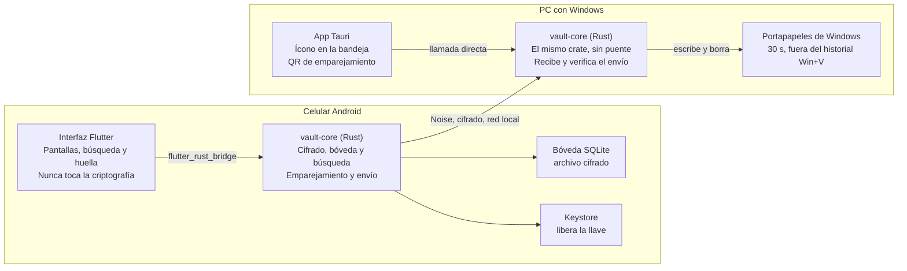

# Especificación: gestor de contraseñas móvil con envío a PC

Actualizado: 2026-11-20

## Resumen y alcance

Un gestor de contraseñas cuyo núcleo vive en el celular Android, con búsqueda rápida por servicio y la opción de enviar una contraseña al portapapeles de una PC con Windows con un solo toque. Por ahora es de uso personal, pero las decisiones de diseño no deben impedir lanzarlo como producto más adelante.

**Objetivos de la primera versión:**

- Guardar contraseñas en una bóveda cifrada en Android, desbloqueable con huella o contraseña maestra.
- Encontrar cualquier entrada en segundos buscando por servicio, URL, usuario o etiquetas.
- Enviar una contraseña a la PC emparejada por red local; en Windows queda en el portapapeles 30 segundos, fuera del historial.
- Exportar e importar respaldos cifrados para no perder todo si se extravía el celular.

**Principios:** cifrado correcto desde el primer día, formato de datos con versión y sin servidor en esta etapa.

## Arquitectura

Todo lo crítico (cifrado, bóveda, búsqueda y protocolo) se escribe una sola vez en Rust y lo usan ambas apps.



Flutter llega al núcleo por flutter_rust_bridge; la app de Tauri lo usa directamente, y entre ambos núcleos viaja un canal Noise por la red local.

| Necesidad | Crate o herramienta |
| --- | --- |
| Derivar la llave de la contraseña maestra | `argon2` |
| Normalizar a NFC la contraseña maestra | `unicode-normalization` (`=0.1.26`) |
| Cifrar entradas | `chacha20poly1305` |
| Borrar secretos de memoria | `zeroize` |
| Base de datos local | `rusqlite` |
| Canal cifrado entre dispositivos | `snow` (protocolo Noise) |
| Derivar la llave pública X25519 desde la privada | `x25519-dalek` (`static_secrets` y `zeroize`) |
| Descubrir la PC en la red | `mdns-sd` |
| Portapapeles de Windows | `arboard` |
| Puente Flutter ↔ Rust | `flutter_rust_bridge` |
| App de escritorio | Tauri 2 |

## La bóveda

La contraseña maestra nunca cifra las entradas directamente: protege una llave de bóveda aleatoria, que es la que cifra todo.

**Llaves.** Al crear la bóveda se genera una llave de bóveda de 256 bits. La contraseña maestra pasa por Argon2id, calibrado para tardar unos 0.5 s en el celular, y la llave resultante cifra la llave de bóveda. El Keystore de Android guarda otra copia cifrada, que solo se libera con huella. Cambiar la contraseña maestra solo vuelve a cifrar la llave de bóveda.

**Cifrado por entrada.** Cada entrada tiene dos partes cifradas por separado con XChaCha20-Poly1305:

| Parte | Contenido | Cuándo se descifra |
| --- | --- | --- |
| Datos de búsqueda | Servicio, URL, usuario, etiquetas | Al desbloquear |
| Secreto | Contraseña, notas | Solo al copiar, mostrar o enviar |

El identificador de la entrada va ligado al cifrado como dato autenticado, para impedir intercambiar el secreto de una entrada con el de otra. Los secretos se borran de memoria tras usarse (crate `zeroize`).

**Almacenamiento.** SQLite administrado por el núcleo (`rusqlite`). La tabla de cabecera guarda la versión del formato, los parámetros y la sal de Argon2 y la llave de bóveda cifrada. La tabla de entradas guarda identificador, versión de estructura, las dos partes cifradas, fecha de modificación y una marca de eliminada. Los dos últimos campos preparan la sincronización futura.

**Bloqueo automático.** Tras un tiempo de inactividad o al pasar la app a segundo plano, la llave de bóveda se borra de memoria.

Decidido el 2026-11-08 (#39, detalle en `docs/superpowers/specs/2026-11-08-bloqueo-automatico-design.md`):

- **Disparador:** `AppLifecycleState.hidden`, que en Android precede a `onStop` (botón de inicio, otra app, pantalla apagada). `inactive` no bloquea: llega con los diálogos del sistema (incluida la huella), la cortina de notificaciones y el selector de recientes, que no sacan al usuario de la app.
- **Inactividad:** 5 minutos fijos hasta la etapa 4, que agrega el ajuste. El valor vive en una sola constante (`defaultAutoLockTimeout`). Cuenta solo con la bóveda desbloqueada en pantalla.
- **Actividad:** cualquier toque en la app, las teclas físicas y escribir en un campo de las pantallas de la bóveda (`ActivityTextField` o `PasswordField`).
- **Al bloquear:** se borra la llave en Rust, se cierran todas las rutas sobre la raíz y los `SnackBar`, y se monta un desbloqueo nuevo. La fachada bloquea aunque el `Mutex` esté envenenado (`PoisonError::into_inner`), así que `lock()` no falla en la práctica; el envenenamiento se conserva para el resto de las operaciones.
- **Operaciones en curso:** toda operación asíncrona que termina con Rust desbloqueado (desbloqueo con contraseña o con huella, crear la bóveda, `AlreadyUnlocked`) revisa el ciclo de vida al terminar y, si la app está en `hidden`, `paused` o `detached`, bloquea en lugar de mostrar la bóveda. Con un desbloqueo en curso no se llama a `lock()` al ocultarse, para no desfasar Rust y la interfaz durante Argon2id. Durante la activación de la huella con la casilla, Rust ya está desbloqueado y sí se bloquea al ocultarse.
- **Huella al ocultarse:** la app cancela el diálogo en `onStop` (`BiometricVault.cancelPrompt` desde `MainActivity.onStop`) y responde `canceled` de inmediato, sin esperar el callback del sistema. Si la cancelación vino de ocultar la app, se vuelve a pedir la huella una vez al volver; si la canceló el usuario, se queda en la contraseña. Android 16 cierra el diálogo por su cuenta al tocar inicio, antes de `onPause` y con el mismo código que una cancelación del usuario (`ERROR_USER_CANCELED`): una cancelación que llega con la app en `inactive` cuenta como del sistema si `hidden` llega en menos de 1 s. El diálogo automático espera a que la app esté en `resumed`.
- **Miniatura de recientes:** Android la toma al salir, posiblemente antes de que se pinte el desbloqueo. Ocultarla le corresponde a la protección de pantalla (`FLAG_SECURE`, #43; ver "Protección de pantalla"), no al bloqueo.
- **Selector de archivos y otras actividades:** `AutoLockController.runWithoutAutoLock<T>` (#44, detalle en `docs/superpowers/specs/2026-11-14-respaldos-selector-design.md`), genérico: la etapa 3 puede usarlo para el escáner del QR. Mientras corre, ocultarse no bloquea y el temporizador de inactividad no corre; al terminar, la cuenta se reinicia. No se anida: una segunda llamada lanza `StateError`. Tope de 2 minutos fuera de la app: un temporizador y, al volver a `resumed`, la comparación de la hora (Android puede congelar el temporizador en segundo plano); superado, bloquea y descarta el resultado del selector.

**Errores.** Una contraseña maestra incorrecta hace fallar el descifrado de la llave de bóveda y la app solo muestra "Contraseña incorrecta". Una entrada corrupta se marca como dañada sin bloquear el resto.

**Respaldos.** Exportación del archivo de bóveda cifrado, que puede guardarse en la PC o en la nube porque es ilegible sin la contraseña maestra, e importación en un celular nuevo.

## Formato de la bóveda

Decisiones tomadas el 2026-11-07, antes de implementar las llaves. Fijan el formato en disco: cambiar cualquiera de ellas sube la versión del formato e incluye una migración.

**Cabecera y llaves.**

- `calibrate()` mide en el dispositivo y elige los parámetros de Argon2id para tardar unos 0.5 s, sin bajar nunca de 64 MiB de memoria, 3 iteraciones y paralelismo 1. Las pruebas usan exactamente esos mínimos.
- Calibración (decidida el 2026-11-07): primero sube la memoria en pasos de 16 MiB hasta un tope de 128 MiB, para que la bóveda pueda abrirse en celulares con menos memoria libre que el que la creó; al llegar al tope sube las iteraciones. El paralelismo queda fijo en 1. `calibrate()` solo corre al crear la bóveda o al cambiar la contraseña maestra.
- Al leer una cabecera se rechazan una versión de formato o un algoritmo desconocidos, y parámetros fuera de los límites: memoria fuera de 64–128 MiB, menos de 3 iteraciones o paralelismo distinto de 1.
- Código (decidido el 2026-11-07): `crypto/keys.rs` deriva la llave maestra y cifra o descifra con ella la llave de bóveda; `vault/header.rs` codifica la cabecera como dato autenticado, la lee y la valida.
- La cabecera guarda por separado (no como cadena PHC): versión del formato, algoritmo de derivación, memoria, iteraciones, paralelismo, sal de 16 bytes y la llave de bóveda cifrada con su nonce.
- Al cifrar la llave de bóveda, los campos de la cabecera (versión de la cabecera, algoritmo, parámetros y sal) van como dato autenticado, en binario de ancho fijo y little-endian: `versión de la cabecera (u16) | algoritmo (u8) | memoria en KiB (u32) | iteraciones (u32) | paralelismo (u32) | sal (16 bytes)`. La **versión de la cabecera** (`HEADER_VERSION`) describe la estructura de la tabla `header`, es independiente de `format_version` y solo cambia cuando esa tabla cambia: vale 1 para la v1 y 2 para la v2 y las siguientes (ver "Formato v3"). El algoritmo `1` es Argon2id versión 0x13. Alterar cualquier parámetro de la cabecera hace fallar el descifrado.
- En el `Cargo.toml` de la raíz, `[profile.dev.package.argon2]` y `[profile.dev.package.blake2]` llevan `opt-level = 3` para que las pruebas en modo debug no sean lentas. Se agregan junto con la dependencia `argon2`.
- Contraseña maestra en NFC (decidido el 2026-11-18, #57; detalle en `docs/superpowers/specs/2026-11-18-nfc-contrasena-maestra-design.md`):
  - Qué recibe Argon2id: los bytes UTF-8 de la contraseña **en forma NFC** (no NFKC, que cambia el significado de caracteres). `é` compuesta (U+00E9) y `e` + acento combinante (U+0065 U+0301) derivan la misma llave. Un solo ayudante (`crypto/normalize.rs`) lo aplica en `kdf::derive_key`, y de ahí en `create`, `unlock`, `change_master_password` (la actual y la nueva), `rekey` e `import`; `password_strength` cuenta los caracteres de la forma NFC.
  - Sin cambio de `format_version`: solo cambian los bytes que recibe Argon2id para una contraseña que no está en NFC. Todo el ASCII y casi todas las letras precompuestas ya están en NFC y derivan la misma llave que antes (vector fijo en las pruebas); no así unos pocos caracteres de compatibilidad, como U+212B (ángstrom) y U+2126 (ohm), que NFC cambia por U+00C5 y U+03A9. `vault-v1.db` y `vault-v2.db` usan `prueba-bóveda-v1/v2` con la "ó" compuesta, ya en NFC, y siguen abriendo sin modificarse.
  - Sin segundo intento: `unlock` no prueba la contraseña original si la NFC falla. Se asume que no existen bóvedas con contraseñas descompuestas porque la decisión se tomó antes de guardar datos reales; una bóveda creada antes con una contraseña no NFC no abriría.
  - Una contraseña que ya está en NFC se usa sin copiarla. Si no, la copia normalizada vive en un `Zeroizing<String>` de capacidad exacta, calculada antes de llenarla, para no dejar restos en un búfer anterior.
  - Excepción de borrado aceptada, junto a la de `nucleo-matcher`: el iterador `nfc()` de `unicode-normalization` usa dos búferes internos (descomposición, de 4 pares, y recomposición, de 4 caracteres) que no se pueden borrar desde fuera. `tinyvec` no borra los `char` al vaciarlos, así que pueden quedar en la pila restos de varios grupos anteriores, no solo del último; si un grupo de marcas pasa de 4, el recorrido sigue en un `Vec` del heap que se libera sin borrar. Cada llamada crea hasta tres iteradores (`is_nfc` con resultado `Maybe`, la pasada de longitud y la de llenado) y `password_strength` corre en cada tecla, así que los restos pueden quedar en varias zonas de la pila. Son unos pocos caracteres, nunca la contraseña entera. Ocurre solo con contraseñas que no están en NFC o que contienen caracteres cuya comprobación rápida no es concluyente (marcas combinantes y algunos jamo coreanos); ASCII y casi todas las letras precompuestas no pasan por el iterador. Se acepta porque las otras opciones eran una primitiva propia con tablas Unicode (prohibida por `core/CLAUDE.md`) o dejar la #57 sin resolver. Si `unicode-normalization` ofrece borrar ese búfer, la excepción se revisa.
  - Fuera de alcance: NFC de las etiquetas y demás datos de búsqueda (ver la limitación de la versión de estructura 1).
- Llave derivada en el heap (decidido el 2026-11-18, #54; detalle en `docs/superpowers/specs/2026-11-18-llave-derivada-en-heap-design.md`):
  - `DerivedKey` es un `SecretBox<[u8; 32]>`, igual que `VaultKey`: mover la llave copia un puntero y no los 32 bytes, que es lo que dejaba copias sin borrar en la pila cuando era un `Zeroizing<[u8; 32]>`. `derive_key` hace que Argon2id escriba su salida directamente en ese búfer; si falla, lo suelta (y se borra) sin copiar nada. El búfer de trabajo de `encrypt_vault_key`, que antes de cifrar guarda la llave de bóveda en claro, va en `Zeroizing`. Una prueba comprueba que ambos tipos miden un puntero; no prueba que no haya copias en la pila, que se cubre con la revisión de código.
  - Los ayudantes que devolvían el cifrador por valor se eliminaron: el cifrador se crea y se usa en la misma función. Es un esfuerzo razonable por evitar movimientos, sin garantía.
  - Memoria de trabajo de Argon2id (corregido el 2026-11-18, #54): `argon2` 0.6.0 reserva sus 64 a 128 MiB con `alloc_zeroed` y los libera sin borrarlos (el `Drop` de `Blocks` solo hace `dealloc`); con paralelismo 1, la llave derivada sale de `blake2b_long` sobre el último bloque, así que esa memoria permitiría recalcularla. `derive_key` reserva ahora la memoria con el tamaño exacto de `block_count` (`try_reserve_exact`, sin que el `Vec` pueda volver a reservar), la pasa a `hash_password_into_with_memory` y la borra al terminar, con éxito o con error (`hash_into`, que recibe el búfer para poder comprobar en una prueba que queda en ceros). Antes de esta corrección, estos textos y el diseño decían que `argon2` con la feature `zeroize` ya borraba sus bloques de trabajo: era falso, y solo borraba `initial_hash` y la copia `blockhash`.
  - La contraseña maestra en el hasher de `argon2` (#54): `argon2` mete la contraseña (en NFC) en un `Blake2b512` para calcular `initial_hash`. Su búfer de bloque (hasta 128 bytes, con la contraseña completa si es corta) y su estado solo se borran con la feature `zeroize`, que `argon2` no propaga. `blake2` está declarada en `core/Cargo.toml` como dependencia directa con `zeroize`, solo para activarla por unificación de features (`blake2/zeroize` activa `digest/zeroize` y `block-buffer/zeroize`); misma versión que resuelve `argon2` (0.6.0) y sin crates nuevos en `Cargo.lock`. Se verificó leyendo el código de `block-buffer` 0.12.1 y `blake2` 0.11.0: el `Drop` borra el búfer y `h`/`t`. No se puede comprobar de forma determinista desde una prueba.
  - Excepción de borrado aceptada, junto a las de `nucleo-matcher` y `nfc()`, para copias internas de dependencias que no controlamos:
    - `argon2` 0.6.0: `blake2b_long` arma el hash completo de 64 bytes en un arreglo de la pila, `full_out`, y copia a la salida los 32 primeros bytes (la llave derivada). `full_out` no se borra, y con una salida de 32 bytes ninguna ruta de la API lo evita. Borrar el estado `h` de `Blake2bVarCore` (lo que hace la feature `zeroize` de `blake2`) no cierra esta exposición, porque `full_out` guarda el mismo hash.
    - `chacha20poly1305` 0.11.0: `ChaChaPoly1305` guarda la llave por valor dentro de la estructura. Se borra al soltarla (feature `zeroize`), pero un movimiento del cifrador puede dejar copias en la pila.
    - `chacha20` 0.10.2: `XChaChaCore::new` deja en la pila la subllave que produce `hchacha` y su estado, sin borrarlos. No es la llave, pero equivale a ella para ese nonce.
    - Las copias transitorias que el compilador deje en registros y en la pila durante la compresión de BLAKE2.
    - Solo se cierra con una primitiva propia (Argon2id, BLAKE2 o ChaCha20-Poly1305 con búferes que se borren), y `core/CLAUDE.md` la prohíbe. Se revisa al actualizar cualquiera de las versiones.
  - La contraseña maestra también existe en la memoria de Dart, que no se puede borrar: lo anterior es defensa en profundidad y no cierra la exposición completa.

**Entradas.**

- Identificador: 16 bytes aleatorios del generador del sistema (`getrandom`), guardados como `BLOB`.
- Cada parte (datos de búsqueda y secreto) se serializa con `serde` + `postcard` y se cifra por separado. Se guarda como `nonce (24 bytes) | texto cifrado con etiqueta`.
- Al descifrar, el texto plano va en `Zeroizing<Vec<u8>>` antes de deserializar. La contraseña y las notas del secreto son `SecretString` (`secrecy`): `Debug` no muestra su valor y solo se leen con `expose_secret()`.
- Al cifrar se reserva `24 + len + 16` en un búfer `Zeroizing` (nonce, texto y etiqueta), se cifra `[24..]` con `encrypt_inout_detached` y se agrega la etiqueta sin reasignar; el contenido sale del búfer solo tras cifrar con éxito. Al descifrar se copia `[24..]` a un `Zeroizing<Vec<u8>>`, se usa `decrypt_in_place` y ese búfer se pasa a la deserialización. (`encrypt_in_place_detached` está deprecada en `aead` 0.6.)
- Una parte de menos de 40 bytes (nonce y etiqueta) o que no se autentica cuenta como entrada dañada, igual que una que no se puede deserializar. Esa entrada falla sola: no impide abrir las demás.
- Las dos partes de una entrada se cifran siempre juntas y con la misma versión de estructura.
- Campos y reglas de la versión de estructura 1 (decididos el 2026-11-07; detalle en `docs/superpowers/specs/2026-11-07-modelo-entrada-design.md`):
  - Obligatorios: servicio y contraseña. Opcionales: URL, usuario, etiquetas y notas. Las entradas de solo notas quedan fuera del MVP.
  - El servicio, la URL, el usuario y las etiquetas se recortan; una URL o un usuario en blanco cuentan como ausentes. La contraseña y el contenido de las notas nunca se recortan; unas notas en blanco cuentan como ausentes.
  - Límites en bytes UTF-8 tras normalizar: servicio y usuario 256, URL 2048, contraseña 1024, notas 16384, como máximo 32 etiquetas de 64.
  - Etiquetas sin duplicados, comparando sin distinguir mayúsculas (`to_lowercase`); se conserva la primera forma escrita y el orden. "Médico" y "Medico" son distintas.
  - Al leer una entrada se aplican las reglas de su versión de estructura. Una versión desconocida, bytes mal formados o un contenido que viola las reglas cuentan como entrada dañada.
  - Limitación conocida del MVP: sin normalización Unicode (NFC), una palabra con acentos compuestos y descompuestos cuenta como dos etiquetas distintas.
- Dato autenticado de cada parte, binario de ancho fijo sin separadores (28 bytes):

  | Offset | Campo | Tamaño | Valor |
  | --- | --- | --- | --- |
  | 0–8 | Etiqueta | 9 bytes | ASCII `boveda-v1` |
  | 9–24 | Identificador | 16 bytes | id de la entrada |
  | 25–26 | Versión de estructura | 2 bytes | `u16` little-endian |
  | 27 | Parte | 1 byte | `1` = datos de búsqueda, `2` = secreto |

  Así se rechaza mover un secreto a otra entrada y también intercambiar las dos partes de una misma entrada.
- **Fuera del modelo de amenazas de la v1:** volver una entrada a una versión anterior (rollback). Quien pueda escribir el archivo puede reemplazar ambas partes de una entrada por una copia vieja y válida de la misma entrada, y no se detecta.

**Almacenamiento.** La tabla de entradas guarda, además de las partes cifradas, `modified_at`, `last_used_at` y la marca de eliminada, en claro. `last_used_at` ordena las usadas recientemente cuando no hay texto de búsqueda; revela cuándo se usó una entrada, pero no cuál es.

Decisiones tomadas el 2026-11-07 (detalle en `docs/superpowers/specs/2026-11-07-almacenamiento-design.md`):

- Fechas en milisegundos Unix, como `i64`. El almacenamiento no lee el reloj: recibe la hora de quien llama. `Vault` la lee en un único punto y devuelve un error tipado si el reloj marca una fecha anterior a 1970.
- `PRAGMA application_id = 0x42564C54` ("BVLT") identifica el archivo como bóveda. Es fijo para siempre y no es un control de seguridad, porque no está autenticado. La versión es solo `format_version` de la cabecera; no se usa `user_version`.
- Abrir nunca crea ni modifica el archivo. Un archivo que no es SQLite, o un SQLite con otro `application_id`, da `NotAVault`; una `format_version` desconocida da su propio error. Excepciones, propias de SQLite: al abrir en lectura y escritura revierte un `-journal` caliente, y al cerrar integra las transacciones pendientes de un `-wal`, aunque la apertura falle (por ejemplo, por una versión futura). En ambos casos el contenido se conserva.
- En cada apertura de lectura y escritura se fijan `secure_delete = ON`, `journal_mode = DELETE` y `synchronous = FULL`, después de validar `format_version`: una bóveda de versión futura se rechaza sin cambiarle el modo de diario. La apertura en solo lectura (para validar un respaldo) no los fija: rechaza un archivo en WAL o con un `-journal` caliente, y nunca lo repara.
- Las filas eliminadas son lápidas: `deleted = 1`, `modified_at` actualizado y las dos partes cifradas en `NULL`. Un `CHECK` impide una entrada viva sin partes y una lápida con partes. Una lápida nunca cuenta como entrada dañada.
- Una fila con un id que no mide 16 bytes o una versión fuera de `u16` cuenta como entrada dañada y falla sola.
- Decidido el 2026-11-07 (#22): todas las rutas de la API pública deben ser absolutas; una relativa da `Storage(Io)` sin crear ni modificar nada. El SQLite empaquetado de `rusqlite` se compila con `SQLITE_USE_URI`, así que una ruta que empiece con `file:` se interpretaría como URI (con parámetros como `?mode=`) aunque la conexión no use `SQLITE_OPEN_URI`: las comprobaciones previas tocarían el archivo literal y SQLite abriría otro. Una ruta absoluta no puede empezar así. La comprobación vive en el almacenamiento (`create`, `open`, la apertura en solo lectura y `VACUUM INTO`, que también acepta URIs); `export` e `import` la repiten al principio, antes de tocar el disco.

Esquema de la versión de formato 1:

```sql
CREATE TABLE header (
    id              INTEGER PRIMARY KEY CHECK (id = 1),
    format_version  INTEGER NOT NULL,
    kdf_algorithm   INTEGER NOT NULL,
    kdf_memory_kib  INTEGER NOT NULL,
    kdf_iterations  INTEGER NOT NULL,
    kdf_parallelism INTEGER NOT NULL,
    salt            BLOB NOT NULL CHECK (length(salt) = 16),
    key_nonce       BLOB NOT NULL CHECK (length(key_nonce) = 24),
    encrypted_key   BLOB NOT NULL CHECK (length(encrypted_key) = 48)
) STRICT;

CREATE TABLE entries (
    id                   BLOB PRIMARY KEY NOT NULL,
    entry_schema_version INTEGER NOT NULL,
    search               BLOB,
    secret               BLOB,
    modified_at          INTEGER NOT NULL,   -- ms Unix
    last_used_at         INTEGER,            -- NULL = nunca usada
    deleted              INTEGER NOT NULL DEFAULT 0,
    CHECK ((deleted = 0 AND search IS NOT NULL AND secret IS NOT NULL)
        OR (deleted = 1 AND search IS NULL AND secret IS NULL))
) STRICT, WITHOUT ROWID;
```

**Fuera del modelo de amenazas de la v1:** al confirmar una transacción se borra el `-journal`, pero sus bytes (cifrados) pueden quedar en la memoria flash hasta que el sistema reutilice esos bloques, y `secure_delete` no cubre eso. Tampoco se resuelven aquí los relojes que retroceden o están desfasados entre dispositivos: le corresponde a la sincronización (fase 3).

**Verificador de la llave y formato v2.** Decisiones tomadas el 2026-11-08 (#34, detalle en `docs/superpowers/specs/2026-11-08-desbloqueo-con-llave-design.md`):

- Para desbloquear con la copia de la llave que guarda el Keystore, el núcleo debe comprobar que la llave es de esta bóveda, también si está vacía. En la v1 no hay con qué: `encrypted_key` está cifrada con la llave derivada de la contraseña y `application_id` es igual en todas. La cabecera de la v2 agrega `key_check`: `nonce (24) | etiqueta (16)`, 40 bytes, resultado de cifrar un texto vacío con XChaCha20-Poly1305 y la llave de bóveda.
- Dato autenticado de `key_check`, binario de ancho fijo sin separadores (18 bytes):

  | Offset | Campo | Tamaño | Valor |
  | --- | --- | --- | --- |
  | 0–15 | Etiqueta | 16 bytes | ASCII `boveda-key-check` |
  | 16–17 | Versión de formato | 2 bytes | `u16` little-endian |

  La etiqueta no se confunde con `boveda-v1`, la de las entradas. Como incluye la versión, una migración futura lo regenera (toda migración tiene la llave en memoria). No forma parte del dato autenticado de `encrypted_key`: alterarlo solo inutiliza la huella, y eso ya puede lograrlo quien escriba el archivo.
- XChaCha20-Poly1305 no compromete la llave: se puede construir un texto que se autentique con dos llaves, pero eso exige conocer ambas, y quien altera el archivo no conoce la llave real.
- Lo crea `VaultHeader::rekey`, así que también `create` y `change_master_password` (que lo regenera con la misma llave: la copia del Keystore sigue valiendo). Lo comprueba `unlock_with_key`; `unlock` con contraseña no lo lee, para que la contraseña nunca dependa de él.
- Verificador dañado: `export_vault_key` lo comprueba con la llave en memoria y, si no se autentica, lo regenera con un nonce nuevo antes de entregar la llave; si esa escritura falla, devuelve el error sin la llave. Es seguro porque la llave en memoria ya se autenticó al desbloquear (con `encrypted_key` o con `key_check`): un `key_check` que no se autentica solo puede estar dañado. Con el verificador dañado, la huella falla una vez, la app la desactiva y pide la contraseña, y al reactivarla se repara.
- Migración desde la v1: `open` y la apertura en solo lectura aceptan las versiones 1, 2 y 3, y abrir sigue sin modificar el archivo. `unlock` con contraseña sobre una v1 deriva una sola vez con Argon2id (salvo en la carrera que se describe abajo, que repite la derivación), descifra la llave con el dato autenticado de la v1 y, en una transacción, reconstruye `header` con el procedimiento que documenta SQLite para cambios de esquema (crear `header_v2`, insertar la cabecera v2 con la misma sal y parámetros, nonce nuevo y `key_check`, borrar `header`, renombrar y verificar). Si algo falla en la migración, la bóveda sigue bloqueada, el archivo queda en la última versión confirmada y el error es el de almacenamiento (desde la v3, una v1 migra en dos transacciones, v1→v2 y v2→v3: si la primera se confirma y la segunda falla, el archivo queda en una v2 válida). Dentro de la transacción, antes de tocar nada, se vuelve a leer `format_version`: si otra conexión ya migró la cabecera mientras corría Argon2id, no se sobrescribe (revertiría un cambio de contraseña sin aviso); `unlock` relee la cabecera y verifica la contraseña contra ella, así que con una contraseña ya cambiada da `WrongPassword`; el archivo ya queda migrado por la otra conexión (en v2, o en v3 si esa conexión también hizo la v2→v3). Importar un respaldo v1 o v2 migra la copia temporal antes del renombrado (la v1 pasa por la v2 y las dos terminan en la v3), con la misma llave derivada de la validación, y cualquier respaldo, también uno v3, queda sin identidad ni PCs (ver "Respaldos" y "Formato v3"); si al migrar la copia ya no es v1, cambió después de validarla, y la importación falla con `Storage(Corrupt)` sin instalar nada. `unlock_with_key` sobre una v1 da `WrongVaultKey`.

Esquema de la versión de formato 2 (`entries` no cambia):

```sql
-- "header" va entre comillas para coincidir con lo que deja ALTER TABLE
-- RENAME en la migración desde la v1. La prueba de igualdad de
-- sqlite_schema entre una bóveda migrada y una creada lo comprueba.
CREATE TABLE "header" (
    id              INTEGER PRIMARY KEY CHECK (id = 1),
    format_version  INTEGER NOT NULL,
    kdf_algorithm   INTEGER NOT NULL,
    kdf_memory_kib  INTEGER NOT NULL,
    kdf_iterations  INTEGER NOT NULL,
    kdf_parallelism INTEGER NOT NULL,
    salt            BLOB NOT NULL CHECK (length(salt) = 16),
    key_nonce       BLOB NOT NULL CHECK (length(key_nonce) = 24),
    encrypted_key   BLOB NOT NULL CHECK (length(encrypted_key) = 48),
    key_check       BLOB NOT NULL CHECK (length(key_check) = 40)
) STRICT;
```

**Formato v3: identidad del celular y PCs emparejadas.** Decisiones tomadas el 2026-11-19 (#93, detalle en `docs/superpowers/specs/2026-11-19-identidad-y-pcs-v3-design.md`):

- La v3 **no cambia** `header` ni `entries`: agrega dos tablas. La migración desde la v2 crea las tablas, sube `format_version` a 3 y regenera `key_check` con la versión 3, en una transacción `IMMEDIATE` que relee `format_version` antes de escribir.
- **Versión de la cabecera, independiente de `format_version`.** `encrypted_key` se cifra con la versión de la cabecera (`HEADER_VERSION`, ver "Cabecera y llaves"), no con `format_version`. Por eso la migración v2→v3 no vuelve a cifrar `encrypted_key` y sirve también con `unlock_with_key`, que no tiene la contraseña. `key_check` sí se autentica con `format_version`.
- **Consecuencia para el futuro.** Si una versión posterior cambia la tabla `header`, su migración tendrá que volver a cifrar `encrypted_key` con la contraseña. Entonces `unlock_with_key` no podrá migrarla, igual que hoy no puede con la v1 (da `WrongVaultKey`).
- **Degradación.** Una v3 a la que se le baja `format_version` a 2 a mano: con la contraseña abre (`unlock` no lee `key_check`), y la migración v2→v3 encuentra que las tablas ya existen y falla con `Storage(Corrupt)`, sin escribir y con la bóveda bloqueada. Con la llave, `key_check` (que autentica la versión 3) la rechaza con `WrongVaultKey`. Ese caso lo cubre `key_check`, no `encrypted_key`.
- Una v3 de otra conexión: si otra conexión ya migró mientras esta derivaba, no se sobrescribe nada (como en la v1→v2); con contraseña se vuelve a verificar contra la cabecera actual.

```sql
CREATE TABLE identity (
    id                      INTEGER PRIMARY KEY CHECK (id = 1),
    identity_schema_version INTEGER NOT NULL,
    data                    BLOB NOT NULL CHECK (length(data) = 72)   -- nonce 24 | llave 32 | etiqueta 16
) STRICT;

CREATE TABLE paired_pcs (
    id                BLOB PRIMARY KEY NOT NULL CHECK (length(id) = 16),
    pc_schema_version INTEGER NOT NULL,
    data              BLOB NOT NULL CHECK (length(data) >= 40)        -- nonce 24 | texto | etiqueta 16
) STRICT, WITHOUT ROWID;
```

- **Identidad.** El texto en claro son los 32 bytes de la llave privada X25519, sin serializar. Cualquier secuencia de 32 bytes aleatorios sirve, porque se recorta al usarla: la #94 no debe validarla ni transformarla al leerla. La llave pública no se guarda. Se genera de forma perezosa (`ensure_identity`), con `getrandom`. Dato autenticado, 17 bytes sin separadores: `boveda-identity` (15 bytes) | versión de estructura (`u16` little-endian).
- **PC emparejada.** Todo va cifrado salvo el id (16 bytes aleatorios) y la versión: llave pública (32 bytes, única en la lista), nombre (recortado, de 1 a 128 bytes UTF-8), última IP (4 o 16 bytes, opcional), `paired_at` y `last_seen_at` (ms Unix; este se fija al guardar una IP). Se serializa con `serde` y `postcard`. Dato autenticado, 27 bytes: `boveda-pc` (9 bytes) | id (16) | versión de estructura (`u16` little-endian). Quitar una PC es un `DELETE` real, sin lápida.
- **Ausente no es dañada.** Sin fila, `identity()` da `Ok(None)` y `ensure_identity()` la crea. Una fila que existe pero no se autentica, tiene una versión desconocida o una forma inesperada da `CorruptIdentity`, y `ensure_identity()` **nunca la sobrescribe** (las PCs ya emparejadas conocen esa llave): el emparejamiento queda bloqueado hasta restaurar un respaldo. `reset_identity` no está en el alcance de la #93.
- **PCs dañadas.** Un `CHECK` solo se aplica al escribir: una fila alterada (id que no mide 16 bytes, versión fuera de `u16`, datos que no se autentican, nombre o IP inválidos) cuenta como PC dañada y falla sola. `paired_pcs()` devuelve las válidas, los ids de las dañadas y el número de filas sin id; `remove_paired_pc` quita también una dañada.
- Nada de esto se carga al desbloquear: `UnlockReport` no cambia y una identidad o una PC dañada nunca impide abrir la bóveda ni las entradas.
- Errores nuevos, sin datos: `CorruptIdentity`, `CorruptPairedPc`, `PairedPcNotFound`, `PairedPcExists` e `InvalidPairedPc` (`NameEmpty`, `NameTooLong`). La fachada los mapea de forma provisional a errores existentes hasta la #102.
- `export_vault_key` y el respaldo no cambian: la llave de bóveda es la misma y `VACUUM INTO` copia las tablas nuevas, así que un respaldo lleva la llave privada del celular (ver "Modelo de amenazas" en "Emparejamiento y envío").

**API.** Una sola estructura `Vault`. Decisiones tomadas el 2026-11-07 (detalle en `docs/superpowers/specs/2026-11-07-api-boveda-design.md`):

- La llave de bóveda (`SecretBox<[u8; 32]>`) vive junto con la caché de datos de búsqueda descifrados en un solo `Option<Unlocked>`. `lock()` pone `None` y borra ambas de memoria; sobre una bóveda ya bloqueada no hace nada.
- Con la bóveda bloqueada, todas las operaciones salvo `unlock` y `lock` devuelven `Error::Locked`. `unlock()` sobre una bóveda ya desbloqueada devuelve `Error::AlreadyUnlocked`.
- `unlock()` devuelve un `UnlockReport` sin texto plano; las entradas válidas se leen con `entries()`.
- `edit` recibe los datos de búsqueda completos y `SecretChange::Keep` (el secreto no sale del núcleo) o `Replace` (contraseña y notas juntas; repara una entrada dañada). Siempre vuelve a cifrar ambas partes y actualiza `modified_at`, no `last_used_at`.
- `reveal()` actualiza `last_used_at` como mejor esfuerzo: si la escritura en disco falla, devuelve el secreto igual.
- `change_master_password` verifica la contraseña actual antes de calibrar y solo vuelve a cifrar la llave de bóveda, con sal y nonce nuevos.
- `create` sobre una ruta que ya existe devuelve `Error::AlreadyExists`. Un reloj anterior a 1970 devuelve `Error::Clock`.
- Decidido el 2026-11-07 (#22): todas las rutas de la API pública deben ser absolutas (`create`, `open`, `export` e `import`); una relativa da `Storage(Io)` (motivo en "Almacenamiento"). `create` la rechaza antes de calibrar Argon2id.
- Como `rusqlite::Connection` no es `Sync`, el `Mutex` vive en la fachada de `mobile/rust`, no en el núcleo. Decidido el 2026-11-08 (#35, detalle en `docs/superpowers/specs/2026-11-08-fachada-puente-design.md`): la fachada lo implementa en `VaultSession`, un tipo opaco con la ruta y un `Mutex<Option<Vault>>`; el `Option` representa una sesión sin bóveda. Al importar, la fachada suelta la `Vault`, llama a `Vault::import` y, si falla, vuelve a abrir la de la ruta (queda bloqueada, o la sesión sin bóveda si no se puede abrir).
- Decidido el 2026-11-08 (#34): `export_vault_key(&mut self) -> Result<SecretBox<[u8; 32]>>` entrega la llave de bóveda para la copia del Keystore, solo con la bóveda desbloqueada (si no, `Locked`). `unlock_with_key(&mut self, key: SecretBox<[u8; 32]>)` se comporta como `unlock`: `AlreadyUnlocked`, el mismo `UnlockReport` y la misma caché; como `unlock`, se puede llamar con la bóveda bloqueada. Recibe la llave por valor: si falla, la llave se descarta y se borra al soltarse, y para reintentar hay que pedirla de nuevo al Keystore. Una llave de otra bóveda, alterada, un verificador dañado o una bóveda v1 dan `Error::WrongVaultKey` y la bóveda sigue bloqueada.
- Abrir nunca modifica el archivo, pero `unlock` sobre una v1 o una v2 sí escribe (la migra a la v3; `unlock_with_key` también migra una v2), igual que `reveal` escribe `last_used_at`. En un medio de solo lectura, una v1 no se puede desbloquear; hoy no hay bóvedas v1 reales, así que es aceptable.
- Decidido el 2026-11-08 (#36, detalle en `docs/superpowers/specs/2026-11-08-primer-uso-design.md`): la contraseña maestra tiene un mínimo de 12 caracteres Unicode (`chars`, no bytes) y cuenta como fuerte desde 16; no se recorta, así que los espacios cuentan. La regla es solo de longitud, como recomienda NIST SP 800-63B, sin exigir tipos de caracteres. `password_strength(&SecretString) -> PasswordStrength` (`TooShort`, `Acceptable`, `Strong`) la calcula sin copiar el secreto si ya está en NFC (desde la #57 cuenta sobre la forma NFC; ver "Formato de la bóveda"), y la interfaz la usa para el indicador, así que nunca discrepa del núcleo. Se aplica solo en `create` y `change_master_password`, con `Error::PasswordTooShort`; nunca en `unlock`, `unlock_with_key` ni `import`, para que las bóvedas y los respaldos existentes sigan abriendo. Se comprueba antes de calibrar y, al cambiar la contraseña, antes de verificar la actual: con la actual incorrecta y la nueva corta, el error es `PasswordTooShort`. Es un cambio de API, no de formato: no sube la versión ni requiere una bóveda de ejemplo nueva. Se descartó `zxcvbn`: copia la contraseña en cadenas que no se borran y su `Debug` las muestra.
- Decidido el 2026-11-10 (#41, detalle en `docs/superpowers/specs/2026-11-10-entradas-design.md`): `SecretChange` tiene cuatro variantes. Además de `Keep` y `Replace`, `ReplacePassword(SecretString)` cambia solo la contraseña y `ReplaceNotes(Option<SecretString>)` solo las notas (`None` o en blanco las quita): la parte que no se toca se descifra y se vuelve a cifrar sin salir del núcleo, para que una contraseña nunca cruce a Dart solo por editar las notas. `edit` valida el valor nuevo antes de leer la fila y descifrar el secreto vigente, así que un valor no válido da `InvalidEntry` aunque el secreto esté dañado o el id no exista. Con un valor válido, un secreto dañado o una fila ilegible dan `CorruptEntry` sin tocar el archivo: solo `Replace` repara. `Vault::entry(id) -> Result<&EntrySummary>` devuelve una entrada desde la caché, sin tocar el disco ni el secreto; un id inexistente, eliminado o con los datos de búsqueda dañados da `EntryNotFound`, porque una entrada dañada nunca entra en la caché y distinguirla exigiría leer la fila. La fachada expone `edit(id, input, new_password, new_notes)` (ninguno es `Keep`, uno solo es `ReplaceX`, los dos son `Replace`; unas notas vacías las quitan) y `entry(id)`. Es un cambio de API, no de formato.

**Entradas dañadas.** `unlock()` devuelve en su `UnlockReport` los identificadores de las entradas con la fila ilegible o con los datos de búsqueda dañados, y el número de filas dañadas sin un identificador válido, sin fallar por ellas. Los secretos no se descifran al desbloquear, así que un secreto dañado no aparece en el `UnlockReport`: `reveal()` sobre esa entrada devuelve `CorruptEntry`. Ambos casos tienen su prueba: alterar un byte de una sola entrada y comprobar que el resto abre, y que `reveal()` de la dañada devuelve ese error.

**Respaldos.**

- Exportar es una copia consistente del archivo SQLite con `VACUUM INTO`, con la cabecera incluida: un respaldo es una bóveda que abre con la misma contraseña maestra. La copia de la llave en el Keystore no viaja; al restaurar se vuelve a activar la huella.
- Importar solo reemplaza la bóveda actual después de abrir la importada con la contraseña y validar su versión de formato. Si algo falla, la bóveda actual queda intacta.
- Al restaurar un respaldo se descarta la identidad del dispositivo, porque la llave privada del celular viaja dentro de la bóveda, y se vacía la lista de PCs emparejadas que trae el respaldo: esas PCs conocen la llave anterior, así que conservarlas solo produciría rechazos. Importar no genera una identidad: la nueva se crea al emparejar, como en cualquier bóveda. El borrado se hace en la copia temporal, antes del renombrado y dentro de `Vault::import`, para que la bóveda instalada nunca tenga la identidad del respaldo. Después se avisa que hay que emparejar de nuevo. Mientras no se revoque, la PC sigue confiando en la llave vieja; si el celular anterior aún existe, el aviso sugiere quitarlo desde la PC. El borrado lo hace `Vault::import` desde el formato v3 (#93): la bóveda instalada no tiene filas en `identity` ni en `paired_pcs` (tras el `DELETE`, la misma transacción comprueba que quedaron vacías: un respaldo con un `TRIGGER` que ignore el borrado no se instala; garantía lógica, no se promete que los bytes cifrados desaparezcan del archivo); el aviso al usuario y sus pruebas de interfaz son de la #106.

Decisiones tomadas el 2026-11-07 (detalle en `docs/superpowers/specs/2026-11-07-respaldos-design.md`):

- `Vault::export(dest)` exige la bóveda desbloqueada (si no, `Error::Locked`), para que nadie exporte sin que el usuario esté presente. `dest` no debe existir (`AlreadyExists`). El respaldo sale compacto: las partes cifradas de las entradas eliminadas no viajan, y las lápidas sí.
- No hace falta sincronizar el respaldo a mano: con `synchronous = FULL`, SQLite hace el fsync del archivo que genera `VACUUM INTO`.
- `Vault::import(backup, dest, password)` es una función asociada, como `create`: sirve para restaurar sobre una bóveda existente y en un celular nuevo. Quien llama suelta antes su `Vault` sobre `dest` y, si la importación falla, la vuelve a abrir. La contraseña es la del respaldo. Devuelve la bóveda importada, desbloqueada, con su `UnlockReport`.
- Se valida una copia temporal junto a `dest`: se abre en solo lectura, se revisa con `PRAGMA integrity_check`, se desbloquea y se descifran los datos de búsqueda. Las entradas con la fila ilegible o con los datos de búsqueda dañados se reportan y no impiden importar. Después la copia se renombra sobre `dest`. Los secretos no se descifran al importar: uno dañado aparece al usar `reveal()`, con `CorruptEntry`. Es intencional: un secreto se descifra solo al copiar, mostrar o enviar, y validarlos al importar pondría todas las contraseñas en memoria a la vez.
- Si `dest` tiene un `-journal` o un `-wal` (un cierre forzado), se aplica abriéndola antes de reemplazarla; si no se puede abrir, no se reemplaza nada. Reemplazar una base sin su diario caliente la corrompería al aplicarlo sobre el respaldo. Si `dest` no existe, sus `-journal`, `-wal` y `-shm` son huérfanos: se borran antes de instalar el respaldo, porque no hay base que revertir y SQLite aplicaría el diario o el `-wal` viejo sobre el respaldo.
- `export` e `import` exigen rutas absolutas, como toda la API pública (ver "Almacenamiento").
- Único punto sin vuelta atrás: si falla la apertura final, `dest` ya es el respaldo validado y se puede reintentar con `Vault::open`.

Decidido el 2026-11-08 (#35): en Android, la bóveda vive en `noBackupFilesDir` (`boveda.db`), que queda fuera de Auto Backup y de la transferencia entre dispositivos. El único camino de restauración es importar un respaldo: si Android restaurara la bóveda por su cuenta, se saltaría `import` y, desde la etapa 3, la regeneración de la identidad del dispositivo. Por omisión, Auto Backup copia `getFilesDir()`, `getDir()` y `databases/`, y con target 31 o mayor `allowBackup="false"` no siempre desactiva la transferencia entre dispositivos; por eso se eligió el directorio y no una regla de exclusión. Decidido el 2026-11-08 (#38): la copia de la llave de bóveda que cifra el Keystore vive en `noBackupFilesDir/biometric/vault_key.bin` (61 bytes: versión 1 | IV de GCM de 12 bytes | texto cifrado de 48), también fuera de Auto Backup: restaurada en otro celular no serviría, porque la llave del Keystore no viaja.

Decidido el 2026-11-13 (#43): el respaldo automático de Android y la transferencia entre dispositivos quedan desactivados para toda la app, no solo para la bóveda. Los respaldos van únicamente por exportar e importar. Son tres capas en el manifiesto: `android:allowBackup="false"`; `android:dataExtractionRules` (Android 12 o posterior), que excluye todos los dominios del respaldo en la nube y de la transferencia, porque con target 31 o mayor algunos fabricantes no respetan `allowBackup` en la transferencia; y `android:fullBackupContent` (Android 11 o anterior) con las mismas exclusiones. `noBackupFilesDir` sigue siendo el lugar de la bóveda y de la copia del Keystore; las reglas protegen cualquier dato que más adelante se guarde fuera de ahí (ajustes, fechas). Se verifica con `adb shell bmgr backupnow com.jesus.boveda`, que debe rechazar el respaldo, y con `adb shell dumpsys package com.jesus.boveda`, cuyas banderas no deben incluir `ALLOW_BACKUP`. La transferencia entre dispositivos no se prueba: exige dos equipos, y queda cubierta solo por las reglas.

Decidido el 2026-11-14 (#44, detalle en `docs/superpowers/specs/2026-11-14-respaldos-selector-design.md`):

- **Selector del sistema, sin paquete.** Un canal propio de Kotlin (`boveda/backup`, `BackupFiles.kt`) con el Storage Access Framework (`ACTION_CREATE_DOCUMENT` y `ACTION_OPEN_DOCUMENT` con `CATEGORY_OPENABLE`). Copia por flujo entre la URI `content://` y un temporal en `noBackupFilesDir/backup-tmp/`: los bytes del respaldo nunca cruzan a Dart. `file_picker` se descartó: `saveFile` pasaría el respaldo entero por memoria de Dart y `pickFiles` lo copia al caché de la app, fuera de `noBackupFilesDir`.
- **Temporales.** Nombre aleatorio (`<uuid>.bak`); solo Kotlin los crea; cada flujo los borra en un `finally` y Kotlin también si la copia falla a medias; `MainActivity.onCreate` vacía `backup-tmp/` al arrancar. `deleteTemp` y `saveTo` comparan la ruta canónica (`isInsideTempDir`) y rechazan con `invalidPath` lo que no cuelga directamente de `backup-tmp/`. Al importar, el tope es de 20 MiB (`tooLarge`).
- **Exportar.** `exportBackup` hacia un temporal con la bóveda desbloqueada y, después, el selector: así el `Locked` del tope de 2 minutos no aplica. Nombre sugerido `boveda-AAAA-MM-DD.db`, tipo `application/octet-stream`. Si el bloqueo ocurre con el selector abierto, el archivo se escribe igual (es texto cifrado que el usuario eligió guardar) y el aviso se muestra en la pantalla de desbloqueo, una sola vez.
- **Importar.** Desde Ajustes y desde el primer uso ("Restaurar un respaldo"). Pide la contraseña **del respaldo**. Si al volver del selector la bóveda ya se bloqueó, no se importa. El temporal se borra siempre antes de seguir. Con éxito se desactiva la huella (se borran la copia y la llave del Keystore) y se ofrece activarla de nuevo; desde Ajustes, si estaba activa, se reactiva sola con la llave de la bóveda importada y solo se ofrece si el usuario cancela la huella o falla (#86, `docs/superpowers/specs/2026-11-19-huella-tras-importar-design.md`). Si un bloqueo interrumpe la importación (la app se oculta con el diálogo abierto), la importación en curso se espera hasta el final; si termina bien, la pantalla de desbloqueo avisa que ahora vale la contraseña **del respaldo**, y nunca se muestra la bóveda sin desbloquearla.
- **Errores al importar.** La fachada suelta la bóveda y, si la importación falla, la reabre bloqueada. Desde Ajustes, la interfaz se bloquea tras cualquier error y la pantalla de desbloqueo muestra el motivo (texto fijo por tipo de error; nunca datos del archivo ni rutas). En el primer uso no hay bóveda abierta y el error se muestra en el mismo diálogo. Validar el respaldo sin soltar la bóveda queda para la #69.
- **Huella tras `WrongVaultKey`.** La copia de otra bóveda (por ejemplo, la de una bóveda anterior que el respaldo reemplazó) se desactiva sin aviso alarmante: se pide la contraseña y, tras desbloquear, un aviso neutro dice que la huella se desactivó porque la bóveda cambió y que se puede activar de nuevo al desbloquear. Los otros motivos de desactivación conservan el aviso de la #38.

**Búsqueda.** `Vault::search(query)` sobre la caché de datos de búsqueda descifrados; nunca toca el secreto ni el disco. Decisiones tomadas el 2026-11-07 (detalle en `docs/superpowers/specs/2026-11-07-busqueda-design.md`):

- Busca en servicio, dominio de la URL, usuario y cada etiqueta. El dominio se extrae a mano: sin esquema, sin `usuario:clave@`, sin puerto y sin ruta; acepta URLs sin esquema.
- Sin texto, devuelve todas: las usadas más recientemente primero, las nunca usadas al final y, entre empates, por servicio.
- Buscador principal: `nucleo-matcher` (MPL-2.0, permitida en `deny.toml`) por subsecuencia ("gm" encuentra "Gmail"), sin distinguir mayúsculas y con "telefono" encontrando "Teléfono". Cada palabra del texto debe coincidir con algún campo; el puntaje es la suma del mejor de cada palabra. Los signos (`^ ! ' $`) son literales.
- Respaldo, solo si el principal no encuentra nada: distancia OSA (`strsim`) por palabras, sin acentos ni mayúsculas, contra cada palabra de los campos y contra su inicio del mismo largo. Tolera 1 con 3 a 5 caracteres y 2 con 6 o más; las palabras de menos de 3 solo coinciden por subsecuencia.
- Las copias internas de `nucleo-matcher` y `strsim` no se pueden borrar de memoria: es una limitación aceptada, porque son datos de búsqueda y no secretos. La del iterador `nfc()` sobre la contraseña maestra, que sí es un secreto, es una excepción aparte y acotada (ver "Formato de la bóveda", contraseña maestra en NFC), igual que las copias internas de `argon2` y `chacha20poly1305` sobre la llave derivada (ver "Formato de la bóveda", llave derivada en el heap).

## Emparejamiento y envío

Celular y PC se reconocen por llaves permanentes intercambiadas una sola vez mediante un QR, y cada envío viaja cifrado de extremo a extremo con el protocolo Noise.

**Identidades.** Cada app tiene un par de llaves X25519. En Windows se genera al instalarse y la llave privada se guarda protegida con DPAPI. En Android la llave privada se guarda dentro de la bóveda, y como al instalar todavía no hay bóveda, el par se genera de forma perezosa: la primera vez que se necesita, es decir, al emparejar (decidido el 2026-11-19, al planear la etapa 3). Una bóveda sin identidad es válida; la identidad y la lista de PCs emparejadas viven en el formato v3 (ver "Formato v3", #93).

**Tipos del protocolo.** Decidido el 2026-11-20 (#94, detalle en `docs/superpowers/specs/2026-11-20-protocolo-tipos-design.md`). `vault_core::protocol` tiene los tipos y la codificación, sin red; el emparejamiento (#95) y el transporte (#96) se construyen encima.

- **Llaves.** `PublicKey::from_private` deriva la llave pública X25519 con `x25519-dalek` (features `static_secrets` y `zeroize`) desde los 32 bytes de la llave privada **sin recortarlos ni transformarlos**: el recorte lo hace la multiplicación. Son los mismos bytes que guarda la bóveda (`vault::Identity`, #93). `KeyPair::generate` los toma de `getrandom` y escribe directo en un `SecretBox`.
- **Huella.** `Fingerprint`: los primeros 8 bytes de la llave pública en hexadecimal con mayúsculas, agrupados de a dos bytes (`A1B2-C3D4-E5F6-0718`). Es un identificador visual corto para que una persona compare dos pantallas: **no autentica nada y no sustituye a Noise**; con 64 bits se podría fabricar una llave con la misma huella, así que nunca decide en qué confiar. Sin hash ni dependencias.
- **Formato en el cable.** `versión (u8) | tipo (u8) | cuerpo (postcard)`. Versión `1`; tipos `1` = oferta del QR, `2` = envío, `3` = confirmación. Un mensaje mide como máximo 4096 bytes (`MAX_MESSAGE_LEN`, con la cabecera). Decodificar es estricto y en este orden: tamaño (`TooLarge`), versión (`UnsupportedVersion`, sin leer el cuerpo), tipo (`UnexpectedKind`), cuerpo con `postcard::take_from_bytes` (`Truncated` si termina antes, `Malformed` en cualquier otro fallo) bytes sobrantes (`TrailingBytes`: `postcard::from_bytes` los ignoraría), forma canónica (`postcard` acepta varints con ceros de relleno, así que el cuerpo se vuelve a medir y, si no coincide, es `Malformed`: cada mensaje tiene una sola codificación) y, al final, las reglas de los campos (`InvalidField`). Un mensaje vacío es `Truncated`; con un solo byte, la versión se mira antes que la longitud mínima. Los errores (`ProtocolError`) no llevan datos ni reenvían el error de `postcard`, y no son los de `vault::Error`.
- **Oferta del QR** (`PairingOffer`): llave pública de la PC, dirección (`SocketAddr`, IPv4 o IPv6) y código de un solo uso de 32 bytes (`PairingCode`, el PSK de Noise de la #95). Sin fecha de caducidad dentro del QR: los relojes no coinciden y los 2 minutos los cuenta la PC. Puerto distinto de 0 y dirección que no sea no especificada ni multicast, también cuando una IPv6 envuelve una IPv4 (`::ffff:a.b.c.d`); loopback y privadas sí. Una IPv6 va sin zona (`scope id`). El contenido mide como máximo **86 bytes** (`MAX_PAIRING_OFFER_LEN`: IPv6 con un puerto de 3 bytes; con IPv4, 74).
- **Tamaño del QR.** Cuentas con la tabla de la norma ISO 18004, corrección M, sin medir con una biblioteca: en base64url sin relleno, 99 caracteres con IPv4 (versión 6) y 115 con IPv6 (versión 7); en base32 con mayúsculas (modo alfanumérico), versión 5 con IPv4 y versión 6 con IPv6. Una estimación anterior de la versión 5 para base64 era errónea. **La #94 no fija una versión de QR ni la conversión a texto**: la #101 mide el tamaño real con su biblioteca, con IPv4 e IPv6, antes de elegir codificación y nivel de corrección.
- **Envío** (`SendMessage`): `ttl_secs` (exactamente 30 en la versión 1, que se comprueba al construir y al decodificar; relativo, sin hora) y la contraseña, de 1 a 1024 bytes UTF-8 (el mismo límite que una entrada). Los bytes de la contraseña no se modifican nunca: sin recortar ni normalizar a NFC. **Confirmación** (`Ack`): `Copied` o `Failed`. Un dispositivo no emparejado se rechaza en el apretón de manos (#96), no con un mensaje.
- **Borrado de memoria.** La contraseña se serializa con `serialize_str` directamente en un búfer `Zeroizing` de capacidad exacta (el tamaño se calcula antes con `serialized_size`, sin reubicaciones) y se deserializa a una sola `String` de capacidad exacta que pasa a `SecretString` sin copiarse; `secrecy` no activa su feature `serde`, y la serialización de un secreto es solo la del campo de la contraseña. `KeyPair`, `PairingCode` y `SendMessage` se borran al soltarse y su `Debug` no muestra el valor (el de `PairingOffer` tampoco muestra la dirección).
- **Excepción de borrado aceptada** (#94, junto a las de `nucleo-matcher`, `nfc()`, `argon2` y `chacha20poly1305` de "Formato de la bóveda"): `StaticSecret::from([u8; 32])` recibe la llave privada por valor, y un arreglo de 32 bytes es `Copy`, así que queda una copia en la pila de quien llama que `x25519-dalek` no borra; `curve25519-dalek` deja además el escalar recortado en registros y pila durante la multiplicación. Solo se cierra con una primitiva propia, que `core/CLAUDE.md` prohíbe; se mitiga derivando justo después de leer la llave del `SecretBox`, sin retenerla. Lo mismo ocurre al decodificar un `PairingCode` (un `[u8; 32]` en la pila antes del `SecretBox`): es un secreto de 2 minutos y un uso que además se muestra en el QR. Las copias que hace `snow` se documentan en la excepción de la #95 (ver "Emparejamiento con Noise").

**Emparejamiento con Noise.** Decidido el 2026-11-20 (#95, detalle en `docs/superpowers/specs/2026-11-20-emparejamiento-noise-design.md`). `vault_core::protocol` tiene las máquinas de estado del emparejamiento (`pairing.rs`, sin sockets) y un conductor síncrono sobre `Read + Write` (`transport.rs`), sin tokio ni crates de red; se prueba con los dos extremos por `TcpStream` en `127.0.0.1`.

- **Patrón.** `Noise_XKpsk0_25519_ChaChaPoly_BLAKE2s` con prólogo `boveda/emparejamiento/v1`, sobre la dependencia `snow` 0.10 (`default-features = false` y solo `use-curve25519`, `use-chacha20poly1305`, `use-blake2` y `use-getrandom`; sin `std`, que en 0.10.0 activa también `ring` y `sha2`). El celular conoce la llave de la PC por el QR y el código de 32 bytes entra como PSK en la posición 0. Con un código incorrecto la PC no descifra la trama 1 y **cierra sin escribir nada**. Una PC que no tiene la llave privada del QR tampoco puede descifrarla; una trama 2 falsificada o alterada da `PeerNotAuthentic` y el celular **no manda la trama 3**.
- **Tramas.** `longitud (u16 big-endian) | bytes`, de 1 a 512 bytes; el largo se comprueba antes de reservar memoria. Trama 1 `e, es` (48 bytes), 2 `e, ee` (48), 3 `s, se` con el `PairingRequest` (hasta 196) y 4, la `PairingReply` ya en modo de transporte (19).
- **Mensajes nuevos de la versión 1** (`PROTOCOL_VERSION` sigue en 1: la #94 no estaba integrada ni usada). Tipo 4, `PairingRequest`: el nombre del celular (`DeviceName`: recortado, de 1 a 128 bytes UTF-8, sin caracteres de control ni de dirección o separación de texto; solo informativo, **la identidad es la llave pública**). Tipo 5, `PairingReply`: `Accepted` (`01 05 00`) o `Rejected` (`01 05 01`). Un cambio incompatible desde aquí sube la versión.
- **Código de un solo uso** (`PairingSession`, en la PC). Estados `Active { failed }`, `Consumed`, `Expired`, `Exhausted` y `Cancelled`; las transiciones son atómicas (`&mut self`). Caduca a los 120 s desde que se crea la sesión (`Instant`, reloj monótono; se evalúa primero). **Se consume al autenticarse la trama 1**, aunque después el usuario rechace, se cancele o caduque la confirmación. Aguanta 3 intentos fallidos (una trama 1 completa que no autentica, o de largo distinto de 48 bytes) y al tercero queda invalidado; una conexión que se corta, vence o se cancela sin completar la trama 1 no cuenta. Dos conexiones con el código correcto no pueden consumirlo las dos. Alguien en la red puede agotar los intentos y obligar a generar otro código, pero no obtiene acceso. Código incorrecto, caducado, reutilizado o agotado: mismo comportamiento externo (la PC cierra sin escribir nada y el celular ve `Closed`, igual que ante un corte de red); el motivo solo lo ve la app de la PC.
- **Confirmación obligatoria.** Terminar el apretón de manos no autoriza nada. La PC obtiene un `PendingPairing` de solo lectura (llave, huella y nombre; no se pueden cambiar durante el diálogo) y 60 s para decidir; solo `accept` produce el `PairedDevice`. El celular solo obtiene el `PairedPc` con una `Accepted` autenticada (una trama alterada, sin cifrar o de otra sesión no cuenta; `Rejected` es `PairingError::Rejected`) y espera como máximo 65 s. La app muestra el nombre y la huella; la huella no autentica.
- **Autorización, entrega y persistencia** son cosas distintas, y el núcleo solo promete las dos primeras, y solo en su extremo. La autorización criptográfica es la decisión del usuario (`Accepted` cifrada y autenticada por Noise). La entrega: `confirm` primero sondea la conexión (con TCP, la primera escritura tras el cierre del otro extremo sale bien, así que escribir no basta: fin de conexión es `Closed` y cualquier byte del celular es un error) y después escribe la trama 4 completa **antes** de devolver el `PairedDevice`; eso no garantiza que el celular la reciba (queda la carrera de una desconexión entre el sondeo y la escritura). La persistencia es de cada app (#99, #93 y #103) y el núcleo **no promete persistencia atómica entre dispositivos**. Casos que pueden quedar desparejados, aceptados y resueltos por la revocación (#107) o emparejando de nuevo: (a) se corta la red tras escribir `Accepted`: la PC guardó al celular y el celular no guardó a la PC (inofensivo; la PC debe tratar una llave ya existente como actualización); (b) la app de la PC no logra guardar tras `confirm`: el celular guardó a la PC y la PC rechazará esa llave en el envío (#96); (c) la app del celular no logra guardar tras recibir `Accepted`. No hay un mensaje más de acuse.
- **Nombre de la PC.** La PC no lo envía en esta versión; lo resuelve la #103. Mientras tanto, `PairedPc` (llave y dirección del QR, ya autenticadas) ofrece `provisional_name()`, `PC ` más la huella (por ejemplo `PC A1B2-C3D4-E5F6-0718`), válido para `vault::PairedPc`, y `into_new_paired_pc(name)` arma el `NewPairedPc` con esa dirección como última IP.
- **Plazos y cancelación.** Ninguna lectura ni escritura bloquea sin límite: antes de cada una se fija un plazo de como máximo 250 ms, y al vencer se revisan el `CancelToken` y los plazos, así que una lectura bloqueada se cancela en ese tiempo. 10 s por trama y 20 s hasta la trama 3 en la PC. Una trama incompleta, una desconexión o un tiempo agotado dan error, consumen el estado y cierran la conexión; no cuentan como intento. `TimedStream` exige que `read` y `write` vuelvan con `WouldBlock` o `TimedOut` al cumplirse el plazo configurado (`TcpStream` lo cumple). El núcleo no lanza hilos: el temporizador de 60 s del diálogo es de la app (`PendingPairing::deadline`).
- **Excepción de borrado aceptada** (#95, junto a las de #94): `snow` 0.10.0 no depende de `zeroize` y no borra ningún secreto. Pueden quedar en su memoria la llave privada estática y la efímera, el código de un solo uso (copia de 32 bytes en `psks`) y lo derivado de él, el estado simétrico y las llaves de cifrado de los dos sentidos; `curve25519-dalek` 4.1.3 y `blake2` 0.10 no tienen `zeroize` activado. Solo se cerraría con una primitiva o un resolvedor criptográfico propios, que `core/CLAUDE.md` prohíbe. Pasar las llaves como referencias y soltar los estados pronto reduce las copias y su vida, pero **no es borrado seguro**; el secreto más delicado que queda es la llave privada de larga duración del dispositivo.


**Envío con Noise.** Decidido el 2026-11-20 (#96, detalle en `docs/superpowers/specs/2026-11-20-envio-noise-design.md`). `vault_core::protocol` tiene las máquinas de estado del envío (`send.rs`: `Responder`, `AwaitingSend`, `ReceivedSend` en la PC; `Sender`, `AwaitingResponse`, `AwaitingAck` en el celular) y los conductores síncronos `receive_send` y `send_to_pc`, sobre las tramas con plazos y cancelación de `transport.rs` (máximo de trama configurable: 512 bytes en el emparejamiento, 2048 en el envío). Sin tokio ni dependencias nuevas; se prueba por `TcpStream` en `127.0.0.1`.

- **Patrón.** `Noise_IK_25519_ChaChaPoly_BLAKE2s` con prólogo `boveda/envio/v1` y sin PSK. El celular conoce la llave de la PC y la PC aprende la del celular en la trama 1 (`e, es, s, ss`, 96 bytes, sin datos de aplicación); la trama 2 (`e, ee, se`) mide 48 bytes. El `SendMessage` viaja **solo después** del apretón de manos, cifrado por el canal Noise (hasta 1045 bytes con una contraseña de 1024) y la confirmación vuelve cifrada (19 bytes). No hay mensajes nuevos ni cambia `PROTOCOL_VERSION`.
- **Autorización antes de contestar.** La PC consulta la lista de emparejados (un `Fn(&PublicKey) -> bool` que le pasa la app; el núcleo no guarda nada) **después** de autenticar la trama 1 y con la llave estática que recupera `snow`, nunca con una identidad declarada por el cliente. Si no está emparejada, cierra **sin escribir nada** y sin procesar contenido; el celular ve `Closed`, igual que ante un corte de red (`SendError::NotPaired` es solo para la app de la PC). La revocación aplica a conexiones nuevas; una conexión ya autorizada puede terminar su envío.
- **Repeticiones.** La trama 1 puede reenviarse: la PC contestará con una llave efímera nueva, pero quien la reenvía no tiene las llaves privadas del celular y no puede derivar las llaves de transporte ni completar un envío. Una trama 3 capturada de otra sesión no descifra (`Handshake`). Una conexión acepta **un solo envío** y se cierra. Sin identificadores de mensaje ni caché de repeticiones.
- **Plazos.** Los 30 s (`SEND_TTL`, `SendTimeouts::total`) los cuenta la PC con `Instant` desde que acepta la conexión e incluyen el apretón de manos y la recepción **completa y autenticada** del mensaje. Si vencen antes, es `SendError::Expired` y el secreto no llega a la app (no se descifra). Esto **solo limita la recepción**: no demuestra cuándo se generó la contraseña (no hay marcas de hora, los relojes no coinciden). Los 10 s por trama y los 10 s del celular para esperar el `Ack` (`SendTimeouts::ack_wait`) son independientes y no amplían esa ventana. Los 30 s del portapapeles empiezan cuando Windows copia la contraseña (#98).
- **Confirmación.** `Copied` o `Failed`. El núcleo entrega el `SendMessage` a la app (`IncomingSend`) y solo escribe `Copied` cuando la app lo pide (`copied()`) tras escribir en el portapapeles; `failed()` escribe `Failed`. `send_to_pc` devuelve `Result<AckOutcome, SendError>`: un `Failed` de la PC es `Ok(Failed)`. Soltar el `IncomingSend` sin contestar cierra sin `Ack`.
- **Fallos.** Una trama 1 de largo distinto de 96 se rechaza leyendo solo el encabezado; una trama 3 de largo 0 o mayor que 2048 se rechaza antes de reservar memoria; una trama 2 falsa o de otra llave es `PeerNotAuthentic` y **la contraseña no sale**; una trama alterada o sin cifrar es `Handshake`.
- **Borrado de memoria.** `SendMessage` se borra al soltarse y los búferes con el texto plano van en `Zeroizing`. Verificado en el código de `snow` 0.10.0 (`CipherChaChaPoly`): el estado de transporte no guarda el texto plano (cifra y descifra en el búfer del llamador), pero la llave de cifrado de cada sentido (`[u8; 32]`) y las copias que `ChaCha20Poly1305::new` deja en la pila no se borran. Se suma a la excepción de la #95; **no es borrado seguro** de las llaves de transporte.

**Portapapeles de la PC.** Decidido el 2026-11-20 (#98, detalle en `docs/superpowers/specs/2026-11-20-portapapeles-windows-design.md`). El módulo `clipboard` de `desktop/` escribe la contraseña con `arboard` (excluida del historial de Win+V y de la nube), muestra el aviso y la borra a los 30 s. Todavía no recibe nada de la red (#100, #104).

- **Borrado condicional.** **ESTADO (2026-11-20): la exclusión frente a otras aplicaciones NO se cumple con `OpenClipboard(NULL)`**, que es como abre hoy `clipboard-win` (sonda entre procesos: otro proceso pudo abrir, escribir y hasta borrar mientras se «retenía» la apertura; con una ventana propietaria real sí excluye). La #98 no se da por cerrada hasta decidir la corrección; ver «Hallazgo» en `docs/superpowers/specs/2026-11-20-portapapeles-windows-design.md`. A los 30 s, y solo si el portapapeles aún contiene esa contraseña, se vacía. La comprobación se hace por una huella de 64 bits (`RandomState` creada con el gestor; nunca se guarda la contraseña), y la lectura, la comparación y el vaciado ocurren bajo **una sola apertura** del portapapeles (`clipboard-win`), porque `arboard` lo abre y cierra en cada operación y dejaría una ventana en la que otra aplicación podría copiar algo que luego se borraría. Si el portapapeles tiene otro texto, una imagen o está vacío, no se toca; si está ocupado o no se puede leer, se reintenta hasta 3 veces (250 ms) y después se desiste: **nunca se borra a ciegas**.
- **Contraseñas rechazadas.** Una contraseña vacía o con `\0` se rechaza antes de tocar el portapapeles (`InvalidPassword`): Windows la pegaría truncada y Bóveda no debe confirmar una copia que no coincide con lo pegable. No se altera ni se trunca el secreto.
- **Dos envíos seguidos.** El temporizador anterior se cancela solo cuando la nueva escritura salió bien; si falla, conserva su vencimiento. Una escritura de resultado dudoso (error después de haber podido escribir) intenta limpiarse al instante con la huella de esa contraseña y, si no puede comprobarlo, deja una entrada de limpieza con reintentos acotados. Como máximo dos entradas pendientes. Limitación conocida: `arboard` pone el texto y después agrega los formatos de exclusión; si agregarlos falla (o si Windows no registra un formato y `arboard` omite la exclusión sin avisar), la contraseña pudo quedar un instante sin excluir y llegar al historial de Win+V o a la nube antes de la limpieza inmediata, y vaciar el portapapeles no borra entradas del historial. Es muy poco probable y no se puede detectar desde fuera; cerrarlo del todo exigiría escribir también con `clipboard-win` bajo una sola guarda, lo que choca con «escribe con `arboard`». El usuario aceptó provisionalmente este riesgo residual y mantiene `arboard` (2026-11-20). La exclusión del historial y de la nube **no es una garantía absoluta** en ese escenario: si el contenido ya entró al historial, vaciar el portapapeles **no lo elimina de Win+V**.
- **Misma contraseña copiada a mano antes del plazo.** Por contenido no se distingue del envío, así que se borra cuando vence el plazo del envío original. No se usa `GetClipboardSequenceNumber`.
- **Salir de la app.** «Salir» intenta limpiar lo pendiente (hasta 2 s); si Windows no deja comprobar el contenido, no se borra y el cierre sigue.
- **Aviso.** Si el aviso falla, la copia sigue siendo válida y el borrado sigue armado.

**Emparejamiento:**

1. En la bandeja de Windows, "Emparejar celular" muestra un QR con la llave pública de la PC, su dirección en la red local y un código de un solo uso que caduca en 2 minutos.
2. El celular escanea el QR, se conecta y hace un intercambio Noise usando la llave de la PC y el código como secreto adicional.
3. La PC pregunta "¿Emparejar con [nombre del celular]?" y el usuario confirma.
4. Cada dispositivo guarda la llave pública del otro.

**Descubrimiento.** La PC se anuncia por mDNS (crate `mdns-sd`). El celular prueba primero la última dirección conocida, luego mDNS, y como último recurso permite escribir la IP manualmente.

**Envío:**

1. El usuario toca "Enviar a PC" con la bóveda desbloqueada y lo confirma con su huella; la huella se pide en cada envío, sin excepción.
2. El celular abre una conexión corta, hace el intercambio Noise con las llaves conocidas, envía la contraseña con un tiempo de vida de 30 s y espera confirmación.
3. La PC escribe la contraseña en el portapapeles excluida del historial de Win+V y de la nube (crate `arboard`), y muestra la notificación "Contraseña lista para pegar".
4. A los 30 s, la PC borra el portapapeles solo si todavía contiene esa contraseña.

**Errores.** Si la PC no aparece, el celular avisa "No se encontró la PC. ¿Están en la misma red?" y ofrece copiar localmente, con el contenido marcado como sensible. La PC rechaza durante el intercambio cualquier conexión de un celular no emparejado.

**Revocación.** Ambas apps listan los dispositivos emparejados y permiten quitar cualquiera desde cualquier lado.

**Modelo de amenazas.** Alguien en la misma red Wi-Fi no puede leer el contenido ni suplantar a la PC sin su llave privada. La app de escritorio solo escucha en redes marcadas como privadas en el Firewall de Windows.

La llave privada del celular viaja dentro del respaldo exportado, porque el respaldo es la bóveda completa. Es aceptable: el respaldo está cifrado con la contraseña maestra, igual que las contraseñas, y quien lo abra ya tiene todas las contraseñas, una exposición mayor que la llave de emparejamiento. Descartar la identidad al restaurar (ver "Respaldos") protege al celular nuevo, no al viejo: la PC sigue confiando en la llave anterior hasta que se quite ese dispositivo desde la PC, y hasta entonces quien tenga el respaldo y la contraseña maestra podría hacerse pasar por el celular anterior. Por eso el aviso de la restauración sugiere revocarlo.

## Experiencia de uso

El flujo más común debe tomar segundos: abrir la app, poner la huella, escribir "gm", deslizar Gmail y pegar en la PC.

**Primer uso.** Crear la contraseña maestra, con indicador de fortaleza y la advertencia de que no se puede recuperar. La app calibra Argon2, ofrece activar la huella e invita a hacer el primer respaldo.

**Desbloqueo.** Huella normalmente; contraseña maestra obligatoria cada 7 días para no olvidarla.

Decidido el 2026-11-08 (#38, detalle en `docs/superpowers/specs/2026-11-08-huella-keystore-design.md`): la huella solo se ofrece desde Android 11 (API 30), con `BIOMETRIC_STRONG` y sin PIN ni credencial del dispositivo; en versiones anteriores queda solo la contraseña. La llave del Keystore exige huella en cada uso y se invalida al registrar una huella nueva. Se ofrece activarla al terminar el primer uso y con una casilla en el desbloqueo con contraseña. Al abrir con la huella activa, primero se pide la huella. La huella se desactiva, con un aviso, solo si la llave del Keystore quedó invalidada o no existe, si la copia es ilegible o si el núcleo da `WrongVaultKey`; cancelar, el bloqueo temporal por intentos y cualquier otro error solo vuelven a la contraseña. La fecha del último desbloqueo con contraseña, para la regla de 7 días, se guarda en la etapa 4: si no hay fecha, se pide la contraseña.

Decidido el 2026-11-08 (#37, detalle en `docs/superpowers/specs/2026-11-08-desbloqueo-contrasena-design.md`): no hay límite ni espera entre intentos con la contraseña maestra; cada intento ya cuesta unos 0.5 s de Argon2id y quien tiene el archivo ataca sin conexión, sin pasar por la interfaz. Si el `UnlockReport` trae entradas dañadas, la pantalla principal muestra un aviso una vez por desbloqueo con el total de dañadas, con y sin identificador ("N entradas no se pudieron leer"), sin impedir el uso. Como complemento de "La bóveda → Errores", cualquier error distinto de la contraseña incorrecta muestra un mensaje genérico ("No se pudo desbloquear la bóveda. Intenta de nuevo."), sin detalles del error.

**Pantalla principal.** Cursor en la barra de búsqueda al desbloquear. La lista se filtra mientras se escribe, tolera errores y busca en servicio, dominio de la URL, usuario y etiquetas. Sin texto, muestra primero las entradas usadas recientemente.

Decidido el 2026-11-10 (#40, detalle en `docs/superpowers/specs/2026-11-10-pantalla-principal-design.md`): la app llama a la búsqueda del núcleo en cada cambio del texto, sin retardo, y descarta las respuestas viejas. Cada elemento muestra el servicio y, debajo, el usuario o, si no hay, la URL tal como está guardada; la lista respeta el orden del núcleo. Las entradas dañadas no aparecen en la lista, porque nunca llegan a la caché de búsqueda: solo las cuenta el aviso del desbloqueo. La búsqueda no se enfoca al llegar: el teclado sale cuando el usuario toca el campo (tras desbloquear con huella, Android descartaba la petición del teclado). En toda la app, tocar fuera de un campo o desplazar una lista cierra el teclado, salvo los controles del mismo formulario (botón de envío, casillas e íconos del campo).

**Acciones:**

- Deslizar una entrada en la lista la envía a la PC sin abrirla.
- El detalle de la entrada ofrece "Enviar a PC" como botón principal, y además copiar, mostrar u ocultar y editar.
- Crear o editar incluye servicio, URL, usuario, contraseña, notas, etiquetas y un generador de contraseñas configurable.

Decidido el 2026-11-10 (#41, detalle en `docs/superpowers/specs/2026-11-10-entradas-design.md`):

- **Revelar.** Abrir el detalle no descifra nada ni cambia el orden de recientes. "Mostrar" (la contraseña) y "Mostrar notas" son acciones separadas, y cada una cuenta como uso. "Mostrar notas" aparece siempre, porque sin descifrar el secreto no se sabe si hay notas; sin notas, muestra "Sin notas". Los textos revelados no son seleccionables (copiar es otra acción, que marca el contenido como sensible), la contraseña va en monoespaciado, y siguen visibles hasta ocultarlos o salir de la pantalla, sin ocultado por tiempo.
- **Formulario.** Al editar, el secreto empieza cerrado: "Cambiar" abre un campo vacío para la contraseña nueva, sin revelar la actual, y "Editar notas" las carga, lo que cuenta como uso. Una sección abierta se envía siempre y una cerrada nunca. Los campos que contienen un secreto (cualquier contraseña y las notas) no dejan copiar ni cortar, ni con el menú de selección ni con un teclado físico; pegar sí. El formulario no aplica la regla de la contraseña maestra: una entrada guarda la contraseña que el servicio exija, aunque sea corta.
- **Validación.** Solo valida el núcleo, al guardar, y el error se muestra en su campo. La app no recorta, no valida vacíos y no conoce los límites. Los mensajes no llevan número: "Este campo es demasiado largo", "Demasiadas etiquetas", "El servicio es obligatorio" y "La contraseña es obligatoria".
- **Etiquetas.** Un chip por etiqueta; Enter o una coma agregan lo escrito, y el texto pendiente se agrega al guardar. Una etiqueta no puede contener una coma: es una limitación de la interfaz, no del formato.
- **Entradas dañadas.** Si el secreto no se puede descifrar, el detalle (o el formulario, al guardar) avisa "La contraseña y las notas de esta entrada están dañadas" y ofrece reparar, escribiendo una contraseña nueva, o eliminar. Las entradas con los datos de búsqueda dañados no aparecen en la lista; verlas y limpiarlas queda para la etapa 4 (#65).
- **Navegación.** Un botón "+" en la pantalla principal abre el formulario; tras crear se muestra el detalle de la entrada nueva, con lo que el núcleo guardó. Tras editar se vuelve al detalle, refrescado. Eliminar pide confirmación, no se puede deshacer y vuelve a la lista. Salir del formulario con cambios pregunta "¿Descartar cambios?". Al volver a la pantalla principal se repite la búsqueda.
- **Bloqueo.** El bloqueo automático con un formulario a medias descarta los cambios sin preguntar: seguridad antes que comodidad.

Decidido el 2026-11-12 (#42, detalle en `docs/superpowers/specs/2026-11-12-copiar-localmente-design.md`): "Copiar" pide la contraseña al núcleo por su cuenta, aunque ya esté visible, y la mantiene solo en una variable local mientras cruza el canal de Kotlin. El clip lleva `android.content.extra.IS_SENSITIVE`; el usuario se copia sin esa marca. Hasta Android 12L la app muestra el aviso de copia y desde Android 13 usa el del sistema. Una contraseña vence a los 30 segundos y solo se borra si el token de su clip sigue en el portapapeles; desde Android 10, si la app no tiene foco y no puede comprobarlo, espera a recuperar el foco en vez de borrar a ciegas. En Android 13 o posterior también aplica el borrado automático del sistema.

**Ajustes.** Dispositivos emparejados, tiempo de bloqueo automático, exportar e importar respaldos y cambiar la contraseña maestra.

**Protección de pantalla.** La app bloquea capturas y oculta su contenido en la vista de apps recientes.

Decidido el 2026-11-13 (#43): `MainActivity` marca su ventana con `FLAG_SECURE` en `onCreate`, antes de que Flutter pinte, en todas las pantallas y en todas las variantes de compilación (también debug). Cubre las capturas, la grabación y la proyección de pantalla, y la miniatura de recientes en los dos casos que el bloqueo automático no alcanza: el selector de recientes, que no saca la app del frente, y la miniatura que Android toma antes de que se pinte el desbloqueo. El diálogo de la huella es una ventana del sistema y no lleva la marca; no muestra contenido de la bóveda.

**Apariencia.** La app tiene un solo tema, oscuro, y no sigue el tema del sistema.

Decidido el 2026-11-19 (D1 de `docs/DESIGN.md`, detalle en `docs/superpowers/specs/2026-11-19-tema-base-design.md`): `MaterialApp` usa el mismo tema oscuro en `theme` y en `darkTheme`, con `themeMode: ThemeMode.dark`; los colores, la tipografía, el espaciado y los radios salen de `mobile/lib/theme/`. El acento es Cyber Lime fijo: el selector de acento (D2) y el resto de decisiones D3 a D6 de `docs/DESIGN.md` siguen pendientes, y mientras no se registren aquí manda esta especificación.

**Frontera entre Flutter y Rust.** Flutter no hace criptografía ni guarda la bóveda: llama al núcleo con funciones como desbloquear, buscar, revelar secreto o enviar a la PC. La búsqueda también vive en el núcleo. Una contraseña solo cruza a Flutter al mostrarla o copiarla localmente; al enviarla a la PC va directo del núcleo a la red.

**Viaje de la llave de bóveda hacia el Keystore** (decidido el 2026-11-08, #34; lo implementa #38). La llave cruza como bytes (`Vec<u8>` en Rust, `Uint8List` en Dart, `ByteArray` en Kotlin), nunca como `String` ni en base64. La fachada pasa los bytes recibidos a `SecretBox` y borra el `Vec` de origen con `zeroize`. En Dart y en Kotlin, el arreglo se sobrescribe con ceros apenas se entrega; es de mejor esfuerzo, como todo borrado fuera del núcleo. El camino Keystore → Rust pasa por Dart lo menos posible: por omisión va por Dart (flutter_rust_bridge y un canal de plataforma); entregar los bytes de Kotlin a la fachada por JNI se evaluó en la #38.

Decidido el 2026-11-08 (#38, detalle en `docs/superpowers/specs/2026-11-08-huella-keystore-design.md`): la llave pasa por Dart (flutter_rust_bridge y el canal `boveda/biometric`), sin JNI. JNI exigiría el crate `jni` y un registro global de sesiones compartido entre flutter_rust_bridge y JNI, contra la decisión de la #35 de no usar estado `static`, para ahorrar un solo salto. Los búferes de `StandardMessageCodec` quedan en la misma excepción de mejor esfuerzo que los de flutter_rust_bridge. Para activar la huella, primero se pide la huella y después la llave sale del núcleo: si el usuario cancela, la llave nunca sale de Rust.

**App de Windows.** Vive en la bandeja del sistema con cuatro opciones: emparejar celular (ventana pequeña con el QR), dispositivos emparejados, iniciar con Windows y salir.

## Estructura del repositorio y orden de construcción

Un solo repositorio con un workspace de Cargo, construido en cuatro etapas que terminan cada una en algo funcional. El detalle de carpetas está en `ARCHITECTURE.md` y el de las etapas en `docs/roadmap.md`.

| Carpeta | Contenido | Tecnología |
| --- | --- | --- |
| `core/` | Crate `vault-core`: bóveda, cifrado, almacenamiento, búsqueda y protocolo | Rust |
| `mobile/` | App Android y capa que expone el núcleo | Flutter + flutter_rust_bridge |
| `desktop/` | App de bandeja de Windows | Tauri 2 (Rust) |

**Etapas:**

1. **Núcleo de la bóveda** con sus pruebas, sin interfaz.
2. **App Android con respaldos.** Al terminar, ya es un gestor de contraseñas usable con búsqueda. El respaldo va aquí porque en cuanto haya contraseñas reales, deben poder recuperarse.
3. **App de Windows, emparejamiento y envío.**
4. **Pulido:** deslizar para enviar, generador de contraseñas, recordatorio de la contraseña maestra y detalles similares.

## Estrategia de pruebas

Las pruebas del núcleo son las más importantes, porque un error ahí puede dejarte sin acceso a tus contraseñas.

**Núcleo:**

- Cifrar y descifrar devuelve exactamente el mismo contenido (también con pruebas de propiedades, crate `proptest`).
- Una contraseña maestra incorrecta falla.
- Modificar un solo byte de una entrada cifrada se detecta.
- Intercambiar el secreto de una entrada con el de otra se rechaza.
- Bóvedas de ejemplo fijas en el repositorio que siempre deben abrirse, para detectar cambios accidentales de formato. Decidido el 2026-11-07: una por versión de formato, `core/tests/fixtures/vault-vN.db` con N igual a la `format_version`; nunca se modifican ni se borran; se generan una sola vez con `KdfParams::MIN`, y las pruebas de integración (`core/tests/vault.rs`) las leen sobre una copia, solo con la API pública (detalle en `docs/superpowers/specs/2026-11-07-pruebas-integracion-design.md`). Desde el 2026-11-08 (#34) existen `vault-v1.db` y `vault-v2.db`; las pruebas también comprueban que una copia de `vault-v1.db` se migra a la v2.
- Exportar, borrar e importar un respaldo recupera todas las entradas.

**Protocolo** (ambos extremos en el mismo proceso, por localhost):

- El emparejamiento con el código correcto funciona.
- Un código incorrecto o caducado falla.
- Un dispositivo no emparejado es rechazado.

**Pruebas manuales en dispositivos reales:**

- [ ] La contraseña no aparece en el historial de Win+V.
- [ ] El portapapeles se borra a los 30 s y no borra algo copiado después.
- [ ] El Firewall solo permite la app en redes privadas.
- [ ] mDNS funciona en la red de casa; la IP manual funciona cuando no.

**Dependencias.** Ejecutar `cargo audit` y `cargo deny` de forma regular para detectar vulnerabilidades conocidas.

## Fuera de alcance y fases futuras

Estas funciones quedan fuera de la primera versión; el diseño actual deja el terreno preparado para cada una.

| Fase | Función | Qué la habilita |
| --- | --- | --- |
| 2 | Relay por internet, para enviar sin estar en la misma red | Cifrado de extremo a extremo ya existente; el servidor solo ve contenido cifrado |
| 2 | Buscar desde la PC y aprobar en el celular | El celular sigue siendo la única fuente de verdad |
| 3 | Sincronización completa con copia de la bóveda en la PC | Fecha de modificación y marca de eliminada por entrada |
| 3 | Autollenado en otras apps de Android | Puede requerir código nativo en Kotlin |
| — | iOS y Mac, si se lanza como producto | Flutter y el núcleo en Rust ya son multiplataforma |
