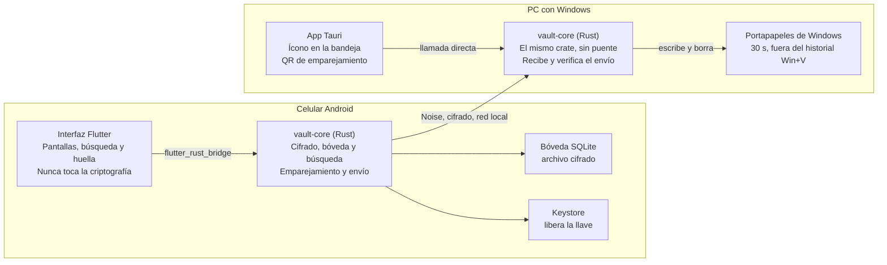

# Especificación: gestor de contraseñas móvil con envío a PC

Actualizado: 2026-11-08

## Resumen y alcance

Un gestor de contraseñas cuyo núcleo vive en el celular Android, con búsqueda rápida por servicio y la opción de enviar una contraseña al portapapeles de una PC con Windows con un solo toque. Por ahora es de uso personal, pero las decisiones de diseño no deben impedir lanzarlo como producto más adelante.

**Objetivos de la primera versión:**

- Guardar contraseñas en una bóveda cifrada en Android, desbloqueable con huella o contraseña maestra.
- Encontrar cualquier entrada en segundos buscando por servicio, URL, usuario o etiquetas.
- Enviar una contraseña a la PC emparejada por red local; en Windows queda en el portapapeles 30 segundos, fuera del historial.
- Exportar e importar respaldos cifrados para no perder todo si se extravía el celular.

**Principios:** cifrado correcto desde el primer día, formato de datos con versión y sin servidor en esta etapa.

## Arquitectura

Todo lo crítico (cifrado, bóveda, búsqueda y protocolo) se escribe una sola vez en Rust y lo usan ambas apps.



Flutter llega al núcleo por flutter_rust_bridge; la app de Tauri lo usa directamente, y entre ambos núcleos viaja un canal Noise por la red local.

| Necesidad | Crate o herramienta |
| --- | --- |
| Derivar la llave de la contraseña maestra | `argon2` |
| Cifrar entradas | `chacha20poly1305` |
| Borrar secretos de memoria | `zeroize` |
| Base de datos local | `rusqlite` |
| Canal cifrado entre dispositivos | `snow` (protocolo Noise) |
| Descubrir la PC en la red | `mdns-sd` |
| Portapapeles de Windows | `arboard` |
| Puente Flutter ↔ Rust | `flutter_rust_bridge` |
| App de escritorio | Tauri 2 |

## La bóveda

La contraseña maestra nunca cifra las entradas directamente: protege una llave de bóveda aleatoria, que es la que cifra todo.

**Llaves.** Al crear la bóveda se genera una llave de bóveda de 256 bits. La contraseña maestra pasa por Argon2id, calibrado para tardar unos 0.5 s en el celular, y la llave resultante cifra la llave de bóveda. El Keystore de Android guarda otra copia cifrada, que solo se libera con huella. Cambiar la contraseña maestra solo vuelve a cifrar la llave de bóveda.

**Cifrado por entrada.** Cada entrada tiene dos partes cifradas por separado con XChaCha20-Poly1305:

| Parte | Contenido | Cuándo se descifra |
| --- | --- | --- |
| Datos de búsqueda | Servicio, URL, usuario, etiquetas | Al desbloquear |
| Secreto | Contraseña, notas | Solo al copiar, mostrar o enviar |

El identificador de la entrada va ligado al cifrado como dato autenticado, para impedir intercambiar el secreto de una entrada con el de otra. Los secretos se borran de memoria tras usarse (crate `zeroize`).

**Almacenamiento.** SQLite administrado por el núcleo (`rusqlite`). La tabla de cabecera guarda la versión del formato, los parámetros y la sal de Argon2 y la llave de bóveda cifrada. La tabla de entradas guarda identificador, versión de estructura, las dos partes cifradas, fecha de modificación y una marca de eliminada. Los dos últimos campos preparan la sincronización futura.

**Bloqueo automático.** Tras un tiempo de inactividad o al pasar la app a segundo plano, la llave de bóveda se borra de memoria.

**Errores.** Una contraseña maestra incorrecta hace fallar el descifrado de la llave de bóveda y la app solo muestra "Contraseña incorrecta". Una entrada corrupta se marca como dañada sin bloquear el resto.

**Respaldos.** Exportación del archivo de bóveda cifrado, que puede guardarse en la PC o en la nube porque es ilegible sin la contraseña maestra, e importación en un celular nuevo.

## Formato de la bóveda

Decisiones tomadas el 2026-11-07, antes de implementar las llaves. Fijan el formato en disco: cambiar cualquiera de ellas sube la versión del formato e incluye una migración.

**Cabecera y llaves.**

- `calibrate()` mide en el dispositivo y elige los parámetros de Argon2id para tardar unos 0.5 s, sin bajar nunca de 64 MiB de memoria, 3 iteraciones y paralelismo 1. Las pruebas usan exactamente esos mínimos.
- Calibración (decidida el 2026-11-07): primero sube la memoria en pasos de 16 MiB hasta un tope de 128 MiB, para que la bóveda pueda abrirse en celulares con menos memoria libre que el que la creó; al llegar al tope sube las iteraciones. El paralelismo queda fijo en 1. `calibrate()` solo corre al crear la bóveda o al cambiar la contraseña maestra.
- Al leer una cabecera se rechazan una versión de formato o un algoritmo desconocidos, y parámetros fuera de los límites: memoria fuera de 64–128 MiB, menos de 3 iteraciones o paralelismo distinto de 1.
- Código (decidido el 2026-11-07): `crypto/keys.rs` deriva la llave maestra y cifra o descifra con ella la llave de bóveda; `vault/header.rs` codifica la cabecera como dato autenticado, la lee y la valida.
- La cabecera guarda por separado (no como cadena PHC): versión del formato, algoritmo de derivación, memoria, iteraciones, paralelismo, sal de 16 bytes y la llave de bóveda cifrada con su nonce.
- Al cifrar la llave de bóveda, los campos de la cabecera (versión, algoritmo, parámetros y sal) van como dato autenticado, en binario de ancho fijo y little-endian: `versión (u16) | algoritmo (u8) | memoria en KiB (u32) | iteraciones (u32) | paralelismo (u32) | sal (16 bytes)`. El algoritmo `1` es Argon2id versión 0x13. Alterar cualquier parámetro de la cabecera hace fallar el descifrado.
- En el `Cargo.toml` de la raíz, `[profile.dev.package.argon2]` y `[profile.dev.package.blake2]` llevan `opt-level = 3` para que las pruebas en modo debug no sean lentas. Se agregan junto con la dependencia `argon2`.

**Entradas.**

- Identificador: 16 bytes aleatorios del generador del sistema (`getrandom`), guardados como `BLOB`.
- Cada parte (datos de búsqueda y secreto) se serializa con `serde` + `postcard` y se cifra por separado. Se guarda como `nonce (24 bytes) | texto cifrado con etiqueta`.
- Al descifrar, el texto plano va en `Zeroizing<Vec<u8>>` antes de deserializar. La contraseña y las notas del secreto son `SecretString` (`secrecy`): `Debug` no muestra su valor y solo se leen con `expose_secret()`.
- Al cifrar se reserva `24 + len + 16` en un búfer `Zeroizing` (nonce, texto y etiqueta), se cifra `[24..]` con `encrypt_inout_detached` y se agrega la etiqueta sin reasignar; el contenido sale del búfer solo tras cifrar con éxito. Al descifrar se copia `[24..]` a un `Zeroizing<Vec<u8>>`, se usa `decrypt_in_place` y ese búfer se pasa a la deserialización. (`encrypt_in_place_detached` está deprecada en `aead` 0.6.)
- Una parte de menos de 40 bytes (nonce y etiqueta) o que no se autentica cuenta como entrada dañada, igual que una que no se puede deserializar. Esa entrada falla sola: no impide abrir las demás.
- Las dos partes de una entrada se cifran siempre juntas y con la misma versión de estructura.
- Campos y reglas de la versión de estructura 1 (decididos el 2026-11-07; detalle en `docs/superpowers/specs/2026-11-07-modelo-entrada-design.md`):
  - Obligatorios: servicio y contraseña. Opcionales: URL, usuario, etiquetas y notas. Las entradas de solo notas quedan fuera del MVP.
  - El servicio, la URL, el usuario y las etiquetas se recortan; una URL o un usuario en blanco cuentan como ausentes. La contraseña y el contenido de las notas nunca se recortan; unas notas en blanco cuentan como ausentes.
  - Límites en bytes UTF-8 tras normalizar: servicio y usuario 256, URL 2048, contraseña 1024, notas 16384, como máximo 32 etiquetas de 64.
  - Etiquetas sin duplicados, comparando sin distinguir mayúsculas (`to_lowercase`); se conserva la primera forma escrita y el orden. "Médico" y "Medico" son distintas.
  - Al leer una entrada se aplican las reglas de su versión de estructura. Una versión desconocida, bytes mal formados o un contenido que viola las reglas cuentan como entrada dañada.
  - Limitación conocida del MVP: sin normalización Unicode (NFC), una palabra con acentos compuestos y descompuestos cuenta como dos etiquetas distintas.
- Dato autenticado de cada parte, binario de ancho fijo sin separadores (28 bytes):

  | Offset | Campo | Tamaño | Valor |
  | --- | --- | --- | --- |
  | 0–8 | Etiqueta | 9 bytes | ASCII `boveda-v1` |
  | 9–24 | Identificador | 16 bytes | id de la entrada |
  | 25–26 | Versión de estructura | 2 bytes | `u16` little-endian |
  | 27 | Parte | 1 byte | `1` = datos de búsqueda, `2` = secreto |

  Así se rechaza mover un secreto a otra entrada y también intercambiar las dos partes de una misma entrada.
- **Fuera del modelo de amenazas de la v1:** volver una entrada a una versión anterior (rollback). Quien pueda escribir el archivo puede reemplazar ambas partes de una entrada por una copia vieja y válida de la misma entrada, y no se detecta.

**Almacenamiento.** La tabla de entradas guarda, además de las partes cifradas, `modified_at`, `last_used_at` y la marca de eliminada, en claro. `last_used_at` ordena las usadas recientemente cuando no hay texto de búsqueda; revela cuándo se usó una entrada, pero no cuál es.

Decisiones tomadas el 2026-11-07 (detalle en `docs/superpowers/specs/2026-11-07-almacenamiento-design.md`):

- Fechas en milisegundos Unix, como `i64`. El almacenamiento no lee el reloj: recibe la hora de quien llama. `Vault` la lee en un único punto y devuelve un error tipado si el reloj marca una fecha anterior a 1970.
- `PRAGMA application_id = 0x42564C54` ("BVLT") identifica el archivo como bóveda. Es fijo para siempre y no es un control de seguridad, porque no está autenticado. La versión es solo `format_version` de la cabecera; no se usa `user_version`.
- Abrir nunca crea ni modifica el archivo. Un archivo que no es SQLite, o un SQLite con otro `application_id`, da `NotAVault`; una `format_version` desconocida da su propio error. Excepciones, propias de SQLite: al abrir en lectura y escritura revierte un `-journal` caliente, y al cerrar integra las transacciones pendientes de un `-wal`, aunque la apertura falle (por ejemplo, por una versión futura). En ambos casos el contenido se conserva.
- En cada apertura de lectura y escritura se fijan `secure_delete = ON`, `journal_mode = DELETE` y `synchronous = FULL`, después de validar `format_version`: una bóveda de versión futura se rechaza sin cambiarle el modo de diario. La apertura en solo lectura (para validar un respaldo) no los fija: rechaza un archivo en WAL o con un `-journal` caliente, y nunca lo repara.
- Las filas eliminadas son lápidas: `deleted = 1`, `modified_at` actualizado y las dos partes cifradas en `NULL`. Un `CHECK` impide una entrada viva sin partes y una lápida con partes. Una lápida nunca cuenta como entrada dañada.
- Una fila con un id que no mide 16 bytes o una versión fuera de `u16` cuenta como entrada dañada y falla sola.
- Decidido el 2026-11-07 (#22): todas las rutas de la API pública deben ser absolutas; una relativa da `Storage(Io)` sin crear ni modificar nada. El SQLite empaquetado de `rusqlite` se compila con `SQLITE_USE_URI`, así que una ruta que empiece con `file:` se interpretaría como URI (con parámetros como `?mode=`) aunque la conexión no use `SQLITE_OPEN_URI`: las comprobaciones previas tocarían el archivo literal y SQLite abriría otro. Una ruta absoluta no puede empezar así. La comprobación vive en el almacenamiento (`create`, `open`, la apertura en solo lectura y `VACUUM INTO`, que también acepta URIs); `export` e `import` la repiten al principio, antes de tocar el disco.

Esquema de la versión de formato 1:

```sql
CREATE TABLE header (
    id              INTEGER PRIMARY KEY CHECK (id = 1),
    format_version  INTEGER NOT NULL,
    kdf_algorithm   INTEGER NOT NULL,
    kdf_memory_kib  INTEGER NOT NULL,
    kdf_iterations  INTEGER NOT NULL,
    kdf_parallelism INTEGER NOT NULL,
    salt            BLOB NOT NULL CHECK (length(salt) = 16),
    key_nonce       BLOB NOT NULL CHECK (length(key_nonce) = 24),
    encrypted_key   BLOB NOT NULL CHECK (length(encrypted_key) = 48)
) STRICT;

CREATE TABLE entries (
    id                   BLOB PRIMARY KEY NOT NULL,
    entry_schema_version INTEGER NOT NULL,
    search               BLOB,
    secret               BLOB,
    modified_at          INTEGER NOT NULL,   -- ms Unix
    last_used_at         INTEGER,            -- NULL = nunca usada
    deleted              INTEGER NOT NULL DEFAULT 0,
    CHECK ((deleted = 0 AND search IS NOT NULL AND secret IS NOT NULL)
        OR (deleted = 1 AND search IS NULL AND secret IS NULL))
) STRICT, WITHOUT ROWID;
```

**Fuera del modelo de amenazas de la v1:** al confirmar una transacción se borra el `-journal`, pero sus bytes (cifrados) pueden quedar en la memoria flash hasta que el sistema reutilice esos bloques, y `secure_delete` no cubre eso. Tampoco se resuelven aquí los relojes que retroceden o están desfasados entre dispositivos: le corresponde a la sincronización (fase 3).

**Verificador de la llave y formato v2.** Decisiones tomadas el 2026-11-08 (#34, detalle en `docs/superpowers/specs/2026-11-08-desbloqueo-con-llave-design.md`):

- Para desbloquear con la copia de la llave que guarda el Keystore, el núcleo debe comprobar que la llave es de esta bóveda, también si está vacía. En la v1 no hay con qué: `encrypted_key` está cifrada con la llave derivada de la contraseña y `application_id` es igual en todas. La cabecera de la v2 agrega `key_check`: `nonce (24) | etiqueta (16)`, 40 bytes, resultado de cifrar un texto vacío con XChaCha20-Poly1305 y la llave de bóveda.
- Dato autenticado de `key_check`, binario de ancho fijo sin separadores (18 bytes):

  | Offset | Campo | Tamaño | Valor |
  | --- | --- | --- | --- |
  | 0–15 | Etiqueta | 16 bytes | ASCII `boveda-key-check` |
  | 16–17 | Versión de formato | 2 bytes | `u16` little-endian |

  La etiqueta no se confunde con `boveda-v1`, la de las entradas. Como incluye la versión, una migración futura lo regenera (toda migración tiene la llave en memoria). No forma parte del dato autenticado de `encrypted_key`: alterarlo solo inutiliza la huella, y eso ya puede lograrlo quien escriba el archivo.
- XChaCha20-Poly1305 no compromete la llave: se puede construir un texto que se autentique con dos llaves, pero eso exige conocer ambas, y quien altera el archivo no conoce la llave real.
- Lo crea `VaultHeader::rekey`, así que también `create` y `change_master_password` (que lo regenera con la misma llave: la copia del Keystore sigue valiendo). Lo comprueba `unlock_with_key`; `unlock` con contraseña no lo lee, para que la contraseña nunca dependa de él.
- Verificador dañado: `export_vault_key` lo comprueba con la llave en memoria y, si no se autentica, lo regenera con un nonce nuevo antes de entregar la llave; si esa escritura falla, devuelve el error sin la llave. Es seguro porque la llave en memoria ya se autenticó al desbloquear (con `encrypted_key` o con `key_check`): un `key_check` que no se autentica solo puede estar dañado. Con el verificador dañado, la huella falla una vez, la app la desactiva y pide la contraseña, y al reactivarla se repara.
- Migración desde la v1: `open` y la apertura en solo lectura aceptan las versiones 1 y 2, y abrir sigue sin modificar el archivo. `unlock` con contraseña sobre una v1 deriva una sola vez con Argon2id (salvo en la carrera que se describe abajo, que repite la derivación), descifra la llave con el dato autenticado de la v1 y, en una transacción, reconstruye `header` con el procedimiento que documenta SQLite para cambios de esquema (crear `header_v2`, insertar la cabecera v2 con la misma sal y parámetros, nonce nuevo y `key_check`, borrar `header`, renombrar y verificar). Si algo falla en la migración, la bóveda sigue bloqueada, el archivo sigue siendo v1 y el error es el de almacenamiento. Dentro de la transacción, antes de tocar nada, se vuelve a leer `format_version`: si otra conexión ya migró la cabecera mientras corría Argon2id, no se sobrescribe (revertiría un cambio de contraseña sin aviso); `unlock` relee la cabecera y verifica la contraseña contra ella, así que con una contraseña ya cambiada da `WrongPassword`; el archivo ya queda en v2, migrado por la otra conexión. Importar un respaldo v1 migra la copia temporal antes del renombrado, con la misma llave derivada de la validación; si al migrar la copia ya no es v1, cambió después de validarla, y la importación falla con `Storage(Corrupt)` sin instalar nada. `unlock_with_key` sobre una v1 da `WrongVaultKey`.

Esquema de la versión de formato 2 (`entries` no cambia):

```sql
-- "header" va entre comillas para coincidir con lo que deja ALTER TABLE
-- RENAME en la migración desde la v1. La prueba de igualdad de
-- sqlite_schema entre una bóveda migrada y una creada lo comprueba.
CREATE TABLE "header" (
    id              INTEGER PRIMARY KEY CHECK (id = 1),
    format_version  INTEGER NOT NULL,
    kdf_algorithm   INTEGER NOT NULL,
    kdf_memory_kib  INTEGER NOT NULL,
    kdf_iterations  INTEGER NOT NULL,
    kdf_parallelism INTEGER NOT NULL,
    salt            BLOB NOT NULL CHECK (length(salt) = 16),
    key_nonce       BLOB NOT NULL CHECK (length(key_nonce) = 24),
    encrypted_key   BLOB NOT NULL CHECK (length(encrypted_key) = 48),
    key_check       BLOB NOT NULL CHECK (length(key_check) = 40)
) STRICT;
```

**API.** Una sola estructura `Vault`. Decisiones tomadas el 2026-11-07 (detalle en `docs/superpowers/specs/2026-11-07-api-boveda-design.md`):

- La llave de bóveda (`SecretBox<[u8; 32]>`) vive junto con la caché de datos de búsqueda descifrados en un solo `Option<Unlocked>`. `lock()` pone `None` y borra ambas de memoria; sobre una bóveda ya bloqueada no hace nada.
- Con la bóveda bloqueada, todas las operaciones salvo `unlock` y `lock` devuelven `Error::Locked`. `unlock()` sobre una bóveda ya desbloqueada devuelve `Error::AlreadyUnlocked`.
- `unlock()` devuelve un `UnlockReport` sin texto plano; las entradas válidas se leen con `entries()`.
- `edit` recibe los datos de búsqueda completos y `SecretChange::Keep` (el secreto no sale del núcleo) o `Replace` (contraseña y notas juntas; repara una entrada dañada). Siempre vuelve a cifrar ambas partes y actualiza `modified_at`, no `last_used_at`.
- `reveal()` actualiza `last_used_at` como mejor esfuerzo: si la escritura en disco falla, devuelve el secreto igual.
- `change_master_password` verifica la contraseña actual antes de calibrar y solo vuelve a cifrar la llave de bóveda, con sal y nonce nuevos.
- `create` sobre una ruta que ya existe devuelve `Error::AlreadyExists`. Un reloj anterior a 1970 devuelve `Error::Clock`.
- Decidido el 2026-11-07 (#22): todas las rutas de la API pública deben ser absolutas (`create`, `open`, `export` e `import`); una relativa da `Storage(Io)` (motivo en "Almacenamiento"). `create` la rechaza antes de calibrar Argon2id.
- Como `rusqlite::Connection` no es `Sync`, el `Mutex` vive en la fachada de `mobile/rust`, no en el núcleo. Decidido el 2026-11-08 (#35, detalle en `docs/superpowers/specs/2026-11-08-fachada-puente-design.md`): la fachada lo implementa en `VaultSession`, un tipo opaco con la ruta y un `Mutex<Option<Vault>>`; el `Option` representa una sesión sin bóveda. Al importar, la fachada suelta la `Vault`, llama a `Vault::import` y, si falla, vuelve a abrir la de la ruta (queda bloqueada, o la sesión sin bóveda si no se puede abrir).
- Decidido el 2026-11-08 (#34): `export_vault_key(&mut self) -> Result<SecretBox<[u8; 32]>>` entrega la llave de bóveda para la copia del Keystore, solo con la bóveda desbloqueada (si no, `Locked`). `unlock_with_key(&mut self, key: SecretBox<[u8; 32]>)` se comporta como `unlock`: `AlreadyUnlocked`, el mismo `UnlockReport` y la misma caché; como `unlock`, se puede llamar con la bóveda bloqueada. Recibe la llave por valor: si falla, la llave se descarta y se borra al soltarse, y para reintentar hay que pedirla de nuevo al Keystore. Una llave de otra bóveda, alterada, un verificador dañado o una bóveda v1 dan `Error::WrongVaultKey` y la bóveda sigue bloqueada.
- Abrir nunca modifica el archivo, pero `unlock` con contraseña sobre una v1 sí escribe (la migra), igual que `reveal` escribe `last_used_at`. En un medio de solo lectura, una v1 no se puede desbloquear; hoy no hay bóvedas v1 reales, así que es aceptable.
- Decidido el 2026-11-08 (#36, detalle en `docs/superpowers/specs/2026-11-08-primer-uso-design.md`): la contraseña maestra tiene un mínimo de 12 caracteres Unicode (`chars`, no bytes) y cuenta como fuerte desde 16; no se recorta, así que los espacios cuentan. La regla es solo de longitud, como recomienda NIST SP 800-63B, sin exigir tipos de caracteres. `password_strength(&SecretString) -> PasswordStrength` (`TooShort`, `Acceptable`, `Strong`) la calcula sin copiar el secreto, y la interfaz la usa para el indicador, así que nunca discrepa del núcleo. Se aplica solo en `create` y `change_master_password`, con `Error::PasswordTooShort`; nunca en `unlock`, `unlock_with_key` ni `import`, para que las bóvedas y los respaldos existentes sigan abriendo. Se comprueba antes de calibrar y, al cambiar la contraseña, antes de verificar la actual: con la actual incorrecta y la nueva corta, el error es `PasswordTooShort`. Es un cambio de API, no de formato: no sube la versión ni requiere una bóveda de ejemplo nueva. Se descartó `zxcvbn`: copia la contraseña en cadenas que no se borran y su `Debug` las muestra.

**Entradas dañadas.** `unlock()` devuelve en su `UnlockReport` los identificadores de las entradas con la fila ilegible o con los datos de búsqueda dañados, y el número de filas dañadas sin un identificador válido, sin fallar por ellas. Los secretos no se descifran al desbloquear, así que un secreto dañado no aparece en el `UnlockReport`: `reveal()` sobre esa entrada devuelve `CorruptEntry`. Ambos casos tienen su prueba: alterar un byte de una sola entrada y comprobar que el resto abre, y que `reveal()` de la dañada devuelve ese error.

**Respaldos.**

- Exportar es una copia consistente del archivo SQLite con `VACUUM INTO`, con la cabecera incluida: un respaldo es una bóveda que abre con la misma contraseña maestra. La copia de la llave en el Keystore no viaja; al restaurar se vuelve a activar la huella.
- Importar solo reemplaza la bóveda actual después de abrir la importada con la contraseña y validar su versión de formato. Si algo falla, la bóveda actual queda intacta.
- Al restaurar un respaldo se regenera la identidad del dispositivo, porque la llave privada del celular viaja dentro de la bóveda. Aplica a partir de la etapa 3.

Decisiones tomadas el 2026-11-07 (detalle en `docs/superpowers/specs/2026-11-07-respaldos-design.md`):

- `Vault::export(dest)` exige la bóveda desbloqueada (si no, `Error::Locked`), para que nadie exporte sin que el usuario esté presente. `dest` no debe existir (`AlreadyExists`). El respaldo sale compacto: las partes cifradas de las entradas eliminadas no viajan, y las lápidas sí.
- No hace falta sincronizar el respaldo a mano: con `synchronous = FULL`, SQLite hace el fsync del archivo que genera `VACUUM INTO`.
- `Vault::import(backup, dest, password)` es una función asociada, como `create`: sirve para restaurar sobre una bóveda existente y en un celular nuevo. Quien llama suelta antes su `Vault` sobre `dest` y, si la importación falla, la vuelve a abrir. La contraseña es la del respaldo. Devuelve la bóveda importada, desbloqueada, con su `UnlockReport`.
- Se valida una copia temporal junto a `dest`: se abre en solo lectura, se revisa con `PRAGMA integrity_check`, se desbloquea y se descifran los datos de búsqueda. Las entradas con la fila ilegible o con los datos de búsqueda dañados se reportan y no impiden importar. Después la copia se renombra sobre `dest`. Los secretos no se descifran al importar: uno dañado aparece al usar `reveal()`, con `CorruptEntry`. Es intencional: un secreto se descifra solo al copiar, mostrar o enviar, y validarlos al importar pondría todas las contraseñas en memoria a la vez.
- Si `dest` tiene un `-journal` o un `-wal` (un cierre forzado), se aplica abriéndola antes de reemplazarla; si no se puede abrir, no se reemplaza nada. Reemplazar una base sin su diario caliente la corrompería al aplicarlo sobre el respaldo. Si `dest` no existe, sus `-journal`, `-wal` y `-shm` son huérfanos: se borran antes de instalar el respaldo, porque no hay base que revertir y SQLite aplicaría el diario o el `-wal` viejo sobre el respaldo.
- `export` e `import` exigen rutas absolutas, como toda la API pública (ver "Almacenamiento").
- Único punto sin vuelta atrás: si falla la apertura final, `dest` ya es el respaldo validado y se puede reintentar con `Vault::open`.

Decidido el 2026-11-08 (#35): en Android, la bóveda vive en `noBackupFilesDir` (`boveda.db`), que queda fuera de Auto Backup y de la transferencia entre dispositivos. El único camino de restauración es importar un respaldo: si Android restaurara la bóveda por su cuenta, se saltaría `import` y, desde la etapa 3, la regeneración de la identidad del dispositivo. Por omisión, Auto Backup copia `getFilesDir()`, `getDir()` y `databases/`, y con target 31 o mayor `allowBackup="false"` no siempre desactiva la transferencia entre dispositivos; por eso se eligió el directorio y no una regla de exclusión. Decidido el 2026-11-08 (#38): la copia de la llave de bóveda que cifra el Keystore vive en `noBackupFilesDir/biometric/vault_key.bin` (61 bytes: versión 1 | IV de GCM de 12 bytes | texto cifrado de 48), también fuera de Auto Backup: restaurada en otro celular no serviría, porque la llave del Keystore no viaja.

**Búsqueda.** `Vault::search(query)` sobre la caché de datos de búsqueda descifrados; nunca toca el secreto ni el disco. Decisiones tomadas el 2026-11-07 (detalle en `docs/superpowers/specs/2026-11-07-busqueda-design.md`):

- Busca en servicio, dominio de la URL, usuario y cada etiqueta. El dominio se extrae a mano: sin esquema, sin `usuario:clave@`, sin puerto y sin ruta; acepta URLs sin esquema.
- Sin texto, devuelve todas: las usadas más recientemente primero, las nunca usadas al final y, entre empates, por servicio.
- Buscador principal: `nucleo-matcher` (MPL-2.0, permitida en `deny.toml`) por subsecuencia ("gm" encuentra "Gmail"), sin distinguir mayúsculas y con "telefono" encontrando "Teléfono". Cada palabra del texto debe coincidir con algún campo; el puntaje es la suma del mejor de cada palabra. Los signos (`^ ! ' $`) son literales.
- Respaldo, solo si el principal no encuentra nada: distancia OSA (`strsim`) por palabras, sin acentos ni mayúsculas, contra cada palabra de los campos y contra su inicio del mismo largo. Tolera 1 con 3 a 5 caracteres y 2 con 6 o más; las palabras de menos de 3 solo coinciden por subsecuencia.
- Las copias internas de `nucleo-matcher` y `strsim` no se pueden borrar de memoria: es una limitación aceptada, porque son datos de búsqueda y no secretos.

## Emparejamiento y envío

Celular y PC se reconocen por llaves permanentes intercambiadas una sola vez mediante un QR, y cada envío viaja cifrado de extremo a extremo con el protocolo Noise.

**Identidades.** Cada app genera al instalarse un par de llaves X25519. En Android, la llave privada se guarda dentro de la bóveda; en Windows, protegida con DPAPI.

**Emparejamiento:**

1. En la bandeja de Windows, "Emparejar celular" muestra un QR con la llave pública de la PC, su dirección en la red local y un código de un solo uso que caduca en 2 minutos.
2. El celular escanea el QR, se conecta y hace un intercambio Noise usando la llave de la PC y el código como secreto adicional.
3. La PC pregunta "¿Emparejar con [nombre del celular]?" y el usuario confirma.
4. Cada dispositivo guarda la llave pública del otro.

**Descubrimiento.** La PC se anuncia por mDNS (crate `mdns-sd`). El celular prueba primero la última dirección conocida, luego mDNS, y como último recurso permite escribir la IP manualmente.

**Envío:**

1. El usuario toca "Enviar a PC" con la bóveda desbloqueada y lo confirma con su huella; la huella se pide en cada envío, sin excepción.
2. El celular abre una conexión corta, hace el intercambio Noise con las llaves conocidas, envía la contraseña con un tiempo de vida de 30 s y espera confirmación.
3. La PC escribe la contraseña en el portapapeles excluida del historial de Win+V y de la nube (crate `arboard`), y muestra la notificación "Contraseña lista para pegar".
4. A los 30 s, la PC borra el portapapeles solo si todavía contiene esa contraseña.

**Errores.** Si la PC no aparece, el celular avisa "No se encontró la PC. ¿Están en la misma red?" y ofrece copiar localmente, con el contenido marcado como sensible. La PC rechaza durante el intercambio cualquier conexión de un celular no emparejado.

**Revocación.** Ambas apps listan los dispositivos emparejados y permiten quitar cualquiera desde cualquier lado.

**Modelo de amenazas.** Alguien en la misma red Wi-Fi no puede leer el contenido ni suplantar a la PC sin su llave privada. La app de escritorio solo escucha en redes marcadas como privadas en el Firewall de Windows.

## Experiencia de uso

El flujo más común debe tomar segundos: abrir la app, poner la huella, escribir "gm", deslizar Gmail y pegar en la PC.

**Primer uso.** Crear la contraseña maestra, con indicador de fortaleza y la advertencia de que no se puede recuperar. La app calibra Argon2, ofrece activar la huella e invita a hacer el primer respaldo.

**Desbloqueo.** Huella normalmente; contraseña maestra obligatoria cada 7 días para no olvidarla.

Decidido el 2026-11-08 (#38, detalle en `docs/superpowers/specs/2026-11-08-huella-keystore-design.md`): la huella solo se ofrece desde Android 11 (API 30), con `BIOMETRIC_STRONG` y sin PIN ni credencial del dispositivo; en versiones anteriores queda solo la contraseña. La llave del Keystore exige huella en cada uso y se invalida al registrar una huella nueva. Se ofrece activarla al terminar el primer uso y con una casilla en el desbloqueo con contraseña. Al abrir con la huella activa, primero se pide la huella. La huella se desactiva, con un aviso, solo si la llave del Keystore quedó invalidada o no existe, si la copia es ilegible o si el núcleo da `WrongVaultKey`; cancelar, el bloqueo temporal por intentos y cualquier otro error solo vuelven a la contraseña. La fecha del último desbloqueo con contraseña, para la regla de 7 días, se guarda en la etapa 4: si no hay fecha, se pide la contraseña.

Decidido el 2026-11-08 (#37, detalle en `docs/superpowers/specs/2026-11-08-desbloqueo-contrasena-design.md`): no hay límite ni espera entre intentos con la contraseña maestra; cada intento ya cuesta unos 0.5 s de Argon2id y quien tiene el archivo ataca sin conexión, sin pasar por la interfaz. Si el `UnlockReport` trae entradas dañadas, la pantalla principal muestra un aviso una vez por desbloqueo con el total de dañadas, con y sin identificador ("N entradas no se pudieron leer"), sin impedir el uso. Como complemento de "La bóveda → Errores", cualquier error distinto de la contraseña incorrecta muestra un mensaje genérico ("No se pudo desbloquear la bóveda. Intenta de nuevo."), sin detalles del error.

**Pantalla principal.** Cursor en la barra de búsqueda al desbloquear. La lista se filtra mientras se escribe, tolera errores y busca en servicio, dominio de la URL, usuario y etiquetas. Sin texto, muestra primero las entradas usadas recientemente.

**Acciones:**

- Deslizar una entrada en la lista la envía a la PC sin abrirla.
- El detalle de la entrada ofrece "Enviar a PC" como botón principal, y además copiar, mostrar u ocultar y editar.
- Crear o editar incluye servicio, URL, usuario, contraseña, notas, etiquetas y un generador de contraseñas configurable.

**Ajustes.** Dispositivos emparejados, tiempo de bloqueo automático, exportar e importar respaldos y cambiar la contraseña maestra.

**Protección de pantalla.** La app bloquea capturas y oculta su contenido en la vista de apps recientes.

**Frontera entre Flutter y Rust.** Flutter no hace criptografía ni guarda la bóveda: llama al núcleo con funciones como desbloquear, buscar, revelar secreto o enviar a la PC. La búsqueda también vive en el núcleo. Una contraseña solo cruza a Flutter al mostrarla o copiarla localmente; al enviarla a la PC va directo del núcleo a la red.

**Viaje de la llave de bóveda hacia el Keystore** (decidido el 2026-11-08, #34; lo implementa #38). La llave cruza como bytes (`Vec<u8>` en Rust, `Uint8List` en Dart, `ByteArray` en Kotlin), nunca como `String` ni en base64. La fachada pasa los bytes recibidos a `SecretBox` y borra el `Vec` de origen con `zeroize`. En Dart y en Kotlin, el arreglo se sobrescribe con ceros apenas se entrega; es de mejor esfuerzo, como todo borrado fuera del núcleo. El camino Keystore → Rust pasa por Dart lo menos posible: por omisión va por Dart (flutter_rust_bridge y un canal de plataforma); entregar los bytes de Kotlin a la fachada por JNI se evaluó en la #38.

Decidido el 2026-11-08 (#38, detalle en `docs/superpowers/specs/2026-11-08-huella-keystore-design.md`): la llave pasa por Dart (flutter_rust_bridge y el canal `boveda/biometric`), sin JNI. JNI exigiría el crate `jni` y un registro global de sesiones compartido entre flutter_rust_bridge y JNI, contra la decisión de la #35 de no usar estado `static`, para ahorrar un solo salto. Los búferes de `StandardMessageCodec` quedan en la misma excepción de mejor esfuerzo que los de flutter_rust_bridge. Para activar la huella, primero se pide la huella y después la llave sale del núcleo: si el usuario cancela, la llave nunca sale de Rust.

**App de Windows.** Vive en la bandeja del sistema con cuatro opciones: emparejar celular (ventana pequeña con el QR), dispositivos emparejados, iniciar con Windows y salir.

## Estructura del repositorio y orden de construcción

Un solo repositorio con un workspace de Cargo, construido en cuatro etapas que terminan cada una en algo funcional. El detalle de carpetas está en `ARCHITECTURE.md` y el de las etapas en `docs/roadmap.md`.

| Carpeta | Contenido | Tecnología |
| --- | --- | --- |
| `core/` | Crate `vault-core`: bóveda, cifrado, almacenamiento, búsqueda y protocolo | Rust |
| `mobile/` | App Android y capa que expone el núcleo | Flutter + flutter_rust_bridge |
| `desktop/` | App de bandeja de Windows | Tauri 2 (Rust) |

**Etapas:**

1. **Núcleo de la bóveda** con sus pruebas, sin interfaz.
2. **App Android con respaldos.** Al terminar, ya es un gestor de contraseñas usable con búsqueda. El respaldo va aquí porque en cuanto haya contraseñas reales, deben poder recuperarse.
3. **App de Windows, emparejamiento y envío.**
4. **Pulido:** deslizar para enviar, generador de contraseñas, recordatorio de la contraseña maestra y detalles similares.

## Estrategia de pruebas

Las pruebas del núcleo son las más importantes, porque un error ahí puede dejarte sin acceso a tus contraseñas.

**Núcleo:**

- Cifrar y descifrar devuelve exactamente el mismo contenido (también con pruebas de propiedades, crate `proptest`).
- Una contraseña maestra incorrecta falla.
- Modificar un solo byte de una entrada cifrada se detecta.
- Intercambiar el secreto de una entrada con el de otra se rechaza.
- Bóvedas de ejemplo fijas en el repositorio que siempre deben abrirse, para detectar cambios accidentales de formato. Decidido el 2026-11-07: una por versión de formato, `core/tests/fixtures/vault-vN.db` con N igual a la `format_version`; nunca se modifican ni se borran; se generan una sola vez con `KdfParams::MIN`, y las pruebas de integración (`core/tests/vault.rs`) las leen sobre una copia, solo con la API pública (detalle en `docs/superpowers/specs/2026-11-07-pruebas-integracion-design.md`). Desde el 2026-11-08 (#34) existen `vault-v1.db` y `vault-v2.db`; las pruebas también comprueban que una copia de `vault-v1.db` se migra a la v2.
- Exportar, borrar e importar un respaldo recupera todas las entradas.

**Protocolo** (ambos extremos en el mismo proceso, por localhost):

- El emparejamiento con el código correcto funciona.
- Un código incorrecto o caducado falla.
- Un dispositivo no emparejado es rechazado.

**Pruebas manuales en dispositivos reales:**

- [ ] La contraseña no aparece en el historial de Win+V.
- [ ] El portapapeles se borra a los 30 s y no borra algo copiado después.
- [ ] El Firewall solo permite la app en redes privadas.
- [ ] mDNS funciona en la red de casa; la IP manual funciona cuando no.

**Dependencias.** Ejecutar `cargo audit` y `cargo deny` de forma regular para detectar vulnerabilidades conocidas.

## Fuera de alcance y fases futuras

Estas funciones quedan fuera de la primera versión; el diseño actual deja el terreno preparado para cada una.

| Fase | Función | Qué la habilita |
| --- | --- | --- |
| 2 | Relay por internet, para enviar sin estar en la misma red | Cifrado de extremo a extremo ya existente; el servidor solo ve contenido cifrado |
| 2 | Buscar desde la PC y aprobar en el celular | El celular sigue siendo la única fuente de verdad |
| 3 | Sincronización completa con copia de la bóveda en la PC | Fecha de modificación y marca de eliminada por entrada |
| 3 | Autollenado en otras apps de Android | Puede requerir código nativo en Kotlin |
| — | iOS y Mac, si se lanza como producto | Flutter y el núcleo en Rust ya son multiplataforma |
