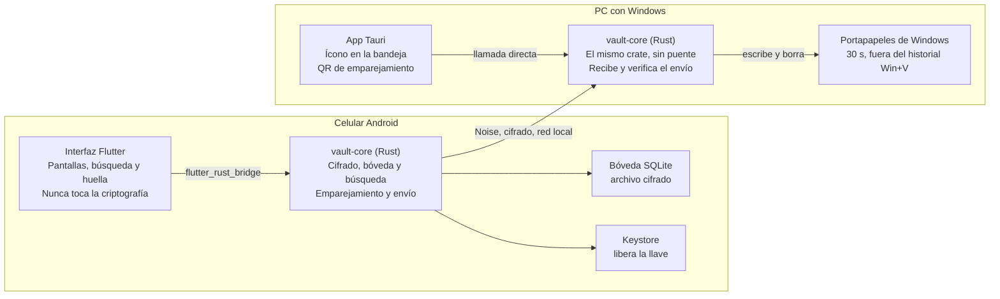

# Especificación: gestor de contraseñas móvil con envío a PC

Actualizado: 2026-11-07

## Resumen y alcance

Un gestor de contraseñas cuyo núcleo vive en el celular Android, con búsqueda rápida por servicio y la opción de enviar una contraseña al portapapeles de una PC con Windows con un solo toque. Por ahora es de uso personal, pero las decisiones de diseño no deben impedir lanzarlo como producto más adelante.

**Objetivos de la primera versión:**

- Guardar contraseñas en una bóveda cifrada en Android, desbloqueable con huella o contraseña maestra.
- Encontrar cualquier entrada en segundos buscando por servicio, URL, usuario o etiquetas.
- Enviar una contraseña a la PC emparejada por red local; en Windows queda en el portapapeles 30 segundos, fuera del historial.
- Exportar e importar respaldos cifrados para no perder todo si se extravía el celular.

**Principios:** cifrado correcto desde el primer día, formato de datos con versión y sin servidor en esta etapa.

## Arquitectura

Todo lo crítico (cifrado, bóveda, búsqueda y protocolo) se escribe una sola vez en Rust y lo usan ambas apps.

Flutter llega al núcleo por flutter_rust_bridge; la app de Tauri lo usa directamente, y entre ambos núcleos viaja un canal Noise por la red local.

| Necesidad | Crate o herramienta |
| --- | --- |
| Derivar la llave de la contraseña maestra | `argon2` |
| Cifrar entradas | `chacha20poly1305` |
| Borrar secretos de memoria | `zeroize` |
| Base de datos local | `rusqlite` |
| Canal cifrado entre dispositivos | `snow` (protocolo Noise) |
| Descubrir la PC en la red | `mdns-sd` |
| Portapapeles de Windows | `arboard` |
| Puente Flutter ↔ Rust | `flutter_rust_bridge` |
| App de escritorio | Tauri 2 |

## La bóveda

La contraseña maestra nunca cifra las entradas directamente: protege una llave de bóveda aleatoria, que es la que cifra todo.

**Llaves.** Al crear la bóveda se genera una llave de bóveda de 256 bits. La contraseña maestra pasa por Argon2id, calibrado para tardar unos 0.5 s en el celular, y la llave resultante cifra la llave de bóveda. El Keystore de Android guarda otra copia cifrada, que solo se libera con huella. Cambiar la contraseña maestra solo vuelve a cifrar la llave de bóveda.

**Cifrado por entrada.** Cada entrada tiene dos partes cifradas por separado con XChaCha20-Poly1305:

| Parte | Contenido | Cuándo se descifra |
| --- | --- | --- |
| Datos de búsqueda | Servicio, URL, usuario, etiquetas | Al desbloquear |
| Secreto | Contraseña, notas | Solo al copiar, mostrar o enviar |

El identificador de la entrada va ligado al cifrado como dato autenticado, para impedir intercambiar el secreto de una entrada con el de otra. Los secretos se borran de memoria tras usarse (crate `zeroize`).

**Almacenamiento.** SQLite administrado por el núcleo (`rusqlite`). La tabla de cabecera guarda la versión del formato, los parámetros y la sal de Argon2 y la llave de bóveda cifrada. La tabla de entradas guarda identificador, versión de estructura, las dos partes cifradas, fecha de modificación y una marca de eliminada. Los dos últimos campos preparan la sincronización futura.

**Bloqueo automático.** Tras un tiempo de inactividad o al pasar la app a segundo plano, la llave de bóveda se borra de memoria.

**Errores.** Una contraseña maestra incorrecta hace fallar el descifrado de la llave de bóveda y la app solo muestra "Contraseña incorrecta". Una entrada corrupta se marca como dañada sin bloquear el resto.

**Respaldos.** Exportación del archivo de bóveda cifrado, que puede guardarse en la PC o en la nube porque es ilegible sin la contraseña maestra, e importación en un celular nuevo.

## Formato de la bóveda

Decisiones tomadas el 2026-11-07, antes de implementar las llaves. Fijan el formato en disco: cambiar cualquiera de ellas sube la versión del formato e incluye una migración.

**Cabecera y llaves.**

- `calibrate()` mide en el dispositivo y elige los parámetros de Argon2id para tardar unos 0.5 s, sin bajar nunca de 64 MiB de memoria, 3 iteraciones y paralelismo 1. Las pruebas usan exactamente esos mínimos.
- Calibración (decidida el 2026-11-07): primero sube la memoria en pasos de 16 MiB hasta un tope de 128 MiB, para que la bóveda pueda abrirse en celulares con menos memoria libre que el que la creó; al llegar al tope sube las iteraciones. El paralelismo queda fijo en 1. `calibrate()` solo corre al crear la bóveda o al cambiar la contraseña maestra.
- Al leer una cabecera se rechazan una versión de formato o un algoritmo desconocidos, y parámetros fuera de los límites: memoria fuera de 64–128 MiB, menos de 3 iteraciones o paralelismo distinto de 1.
- Código (decidido el 2026-11-07): `crypto/keys.rs` deriva la llave maestra y cifra o descifra con ella la llave de bóveda; `vault/header.rs` codifica la cabecera como dato autenticado, la lee y la valida.
- La cabecera guarda por separado (no como cadena PHC): versión del formato, algoritmo de derivación, memoria, iteraciones, paralelismo, sal de 16 bytes y la llave de bóveda cifrada con su nonce.
- Al cifrar la llave de bóveda, los campos de la cabecera (versión, algoritmo, parámetros y sal) van como dato autenticado, en binario de ancho fijo y little-endian: `versión (u16) | algoritmo (u8) | memoria en KiB (u32) | iteraciones (u32) | paralelismo (u32) | sal (16 bytes)`. El algoritmo `1` es Argon2id versión 0x13. Alterar cualquier parámetro de la cabecera hace fallar el descifrado.
- En el `Cargo.toml` de la raíz, `[profile.dev.package.argon2]` y `[profile.dev.package.blake2]` llevan `opt-level = 3` para que las pruebas en modo debug no sean lentas. Se agregan junto con la dependencia `argon2`.

**Entradas.**

- Identificador: 16 bytes aleatorios del generador del sistema (`getrandom`), guardados como `BLOB`.
- Cada parte (datos de búsqueda y secreto) se serializa con `serde` + `postcard` y se cifra por separado. Se guarda como `nonce (24 bytes) | texto cifrado con etiqueta`.
- Al descifrar, el texto plano va en `Zeroizing<Vec<u8>>` antes de deserializar. La contraseña y las notas del secreto son `SecretString` (`secrecy`): `Debug` no muestra su valor y solo se leen con `expose_secret()`.
- Al cifrar se reserva `24 + len + 16` en un búfer `Zeroizing` (nonce, texto y etiqueta), se cifra `[24..]` con `encrypt_inout_detached` y se agrega la etiqueta sin reasignar; el contenido sale del búfer solo tras cifrar con éxito. Al descifrar se copia `[24..]` a un `Zeroizing<Vec<u8>>`, se usa `decrypt_in_place` y ese búfer se pasa a la deserialización. (`encrypt_in_place_detached` está deprecada en `aead` 0.6.)
- Una parte de menos de 40 bytes (nonce y etiqueta) o que no se autentica cuenta como entrada dañada, igual que una que no se puede deserializar. Esa entrada falla sola: no impide abrir las demás.
- Las dos partes de una entrada se cifran siempre juntas y con la misma versión de estructura.
- Campos y reglas de la versión de estructura 1 (decididos el 2026-11-07; detalle en `docs/superpowers/specs/2026-11-07-modelo-entrada-design.md`):
  - Obligatorios: servicio y contraseña. Opcionales: URL, usuario, etiquetas y notas. Las entradas de solo notas quedan fuera del MVP.
  - El servicio, la URL, el usuario y las etiquetas se recortan; una URL o un usuario en blanco cuentan como ausentes. La contraseña y el contenido de las notas nunca se recortan; unas notas en blanco cuentan como ausentes.
  - Límites en bytes UTF-8 tras normalizar: servicio y usuario 256, URL 2048, contraseña 1024, notas 16384, como máximo 32 etiquetas de 64.
  - Etiquetas sin duplicados, comparando sin distinguir mayúsculas (`to_lowercase`); se conserva la primera forma escrita y el orden. "Médico" y "Medico" son distintas.
  - Al leer una entrada se aplican las reglas de su versión de estructura. Una versión desconocida, bytes mal formados o un contenido que viola las reglas cuentan como entrada dañada.
  - Limitación conocida del MVP: sin normalización Unicode (NFC), una palabra con acentos compuestos y descompuestos cuenta como dos etiquetas distintas.
- Dato autenticado de cada parte, binario de ancho fijo sin separadores (28 bytes):

  | Offset | Campo | Tamaño | Valor |
  | --- | --- | --- | --- |
  | 0–8 | Etiqueta | 9 bytes | ASCII `boveda-v1` |
  | 9–24 | Identificador | 16 bytes | id de la entrada |
  | 25–26 | Versión de estructura | 2 bytes | `u16` little-endian |
  | 27 | Parte | 1 byte | `1` = datos de búsqueda, `2` = secreto |

  Así se rechaza mover un secreto a otra entrada y también intercambiar las dos partes de una misma entrada.
- **Fuera del modelo de amenazas de la v1:** volver una entrada a una versión anterior (rollback). Quien pueda escribir el archivo puede reemplazar ambas partes de una entrada por una copia vieja y válida de la misma entrada, y no se detecta.

**Almacenamiento.** La tabla de entradas guarda, además de las partes cifradas, `modified_at`, `last_used_at` y la marca de eliminada, en claro. `last_used_at` ordena las usadas recientemente cuando no hay texto de búsqueda; revela cuándo se usó una entrada, pero no cuál es.

**API.** Una sola estructura `Vault` con la llave en `Option<SecretBox<[u8; 32]>>`. Las operaciones con la bóveda bloqueada devuelven `Error::Locked`. `lock()` borra de memoria la llave de bóveda y los datos de búsqueda descifrados. Como `rusqlite::Connection` no es `Sync`, el `Mutex` vive en la fachada de `mobile/rust`, no en el núcleo.

**Entradas dañadas.** `unlock()` devuelve las entradas válidas y la lista de identificadores de las que no se pudieron descifrar, sin fallar por ellas. `reveal()` sobre una entrada con el secreto dañado devuelve un error de entrada dañada. Ambos casos tienen su prueba: alterar un byte de una sola entrada y comprobar que el resto abre, y que `reveal()` de la dañada devuelve ese error.

**Respaldos.**

- Exportar es una copia consistente del archivo SQLite con `VACUUM INTO`, con la cabecera incluida: un respaldo es una bóveda que abre con la misma contraseña maestra. La copia de la llave en el Keystore no viaja; al restaurar se vuelve a activar la huella.
- Importar solo reemplaza la bóveda actual después de abrir la importada con la contraseña y validar su versión de formato. Si algo falla, la bóveda actual queda intacta.
- Al restaurar un respaldo se regenera la identidad del dispositivo, porque la llave privada del celular viaja dentro de la bóveda. Aplica a partir de la etapa 3.

**Búsqueda (pospuesta hasta su punto del roadmap).** `nucleo-matcher` como buscador principal y `strsim` como respaldo cuando no haya resultados. `nucleo-matcher` tiene licencia MPL-2.0, que ya está permitida en `deny.toml`.

## Emparejamiento y envío

Celular y PC se reconocen por llaves permanentes intercambiadas una sola vez mediante un QR, y cada envío viaja cifrado de extremo a extremo con el protocolo Noise.

**Identidades.** Cada app genera al instalarse un par de llaves X25519. En Android, la llave privada se guarda dentro de la bóveda; en Windows, protegida con DPAPI.

**Emparejamiento:**

1. En la bandeja de Windows, "Emparejar celular" muestra un QR con la llave pública de la PC, su dirección en la red local y un código de un solo uso que caduca en 2 minutos.
2. El celular escanea el QR, se conecta y hace un intercambio Noise usando la llave de la PC y el código como secreto adicional.
3. La PC pregunta "¿Emparejar con [nombre del celular]?" y el usuario confirma.
4. Cada dispositivo guarda la llave pública del otro.

**Descubrimiento.** La PC se anuncia por mDNS (crate `mdns-sd`). El celular prueba primero la última dirección conocida, luego mDNS, y como último recurso permite escribir la IP manualmente.

**Envío:**

1. El usuario toca "Enviar a PC" con la bóveda desbloqueada y lo confirma con su huella; la huella se pide en cada envío, sin excepción.
2. El celular abre una conexión corta, hace el intercambio Noise con las llaves conocidas, envía la contraseña con un tiempo de vida de 30 s y espera confirmación.
3. La PC escribe la contraseña en el portapapeles excluida del historial de Win+V y de la nube (crate `arboard`), y muestra la notificación "Contraseña lista para pegar".
4. A los 30 s, la PC borra el portapapeles solo si todavía contiene esa contraseña.

**Errores.** Si la PC no aparece, el celular avisa "No se encontró la PC. ¿Están en la misma red?" y ofrece copiar localmente, con el contenido marcado como sensible. La PC rechaza durante el intercambio cualquier conexión de un celular no emparejado.

**Revocación.** Ambas apps listan los dispositivos emparejados y permiten quitar cualquiera desde cualquier lado.

**Modelo de amenazas.** Alguien en la misma red Wi-Fi no puede leer el contenido ni suplantar a la PC sin su llave privada. La app de escritorio solo escucha en redes marcadas como privadas en el Firewall de Windows.

## Experiencia de uso

El flujo más común debe tomar segundos: abrir la app, poner la huella, escribir "gm", deslizar Gmail y pegar en la PC.

**Primer uso.** Crear la contraseña maestra, con indicador de fortaleza y la advertencia de que no se puede recuperar. La app calibra Argon2, ofrece activar la huella e invita a hacer el primer respaldo.

**Desbloqueo.** Huella normalmente; contraseña maestra obligatoria cada 7 días para no olvidarla.

**Pantalla principal.** Cursor en la barra de búsqueda al desbloquear. La lista se filtra mientras se escribe, tolera errores y busca en servicio, dominio de la URL, usuario y etiquetas. Sin texto, muestra primero las entradas usadas recientemente.

**Acciones:**

- Deslizar una entrada en la lista la envía a la PC sin abrirla.
- El detalle de la entrada ofrece "Enviar a PC" como botón principal, y además copiar, mostrar u ocultar y editar.
- Crear o editar incluye servicio, URL, usuario, contraseña, notas, etiquetas y un generador de contraseñas configurable.

**Ajustes.** Dispositivos emparejados, tiempo de bloqueo automático, exportar e importar respaldos y cambiar la contraseña maestra.

**Protección de pantalla.** La app bloquea capturas y oculta su contenido en la vista de apps recientes.

**Frontera entre Flutter y Rust.** Flutter no hace criptografía ni guarda la bóveda: llama al núcleo con funciones como desbloquear, buscar, revelar secreto o enviar a la PC. La búsqueda también vive en el núcleo. Una contraseña solo cruza a Flutter al mostrarla o copiarla localmente; al enviarla a la PC va directo del núcleo a la red.

**App de Windows.** Vive en la bandeja del sistema con cuatro opciones: emparejar celular (ventana pequeña con el QR), dispositivos emparejados, iniciar con Windows y salir.

## Estructura del repositorio y orden de construcción

Un solo repositorio con un workspace de Cargo, construido en cuatro etapas que terminan cada una en algo funcional. El detalle de carpetas está en `ARCHITECTURE.md` y el de las etapas en `docs/roadmap.md`.

| Carpeta | Contenido | Tecnología |
| --- | --- | --- |
| `core/` | Crate `vault-core`: bóveda, cifrado, almacenamiento, búsqueda y protocolo | Rust |
| `mobile/` | App Android y capa que expone el núcleo | Flutter + flutter_rust_bridge |
| `desktop/` | App de bandeja de Windows | Tauri 2 (Rust) |

**Etapas:**

1. **Núcleo de la bóveda** con sus pruebas, sin interfaz.
2. **App Android con respaldos.** Al terminar, ya es un gestor de contraseñas usable con búsqueda. El respaldo va aquí porque en cuanto haya contraseñas reales, deben poder recuperarse.
3. **App de Windows, emparejamiento y envío.**
4. **Pulido:** deslizar para enviar, generador de contraseñas, recordatorio de la contraseña maestra y detalles similares.

## Estrategia de pruebas

Las pruebas del núcleo son las más importantes, porque un error ahí puede dejarte sin acceso a tus contraseñas.

**Núcleo:**

- Cifrar y descifrar devuelve exactamente el mismo contenido (también con pruebas de propiedades, crate `proptest`).
- Una contraseña maestra incorrecta falla.
- Modificar un solo byte de una entrada cifrada se detecta.
- Intercambiar el secreto de una entrada con el de otra se rechaza.
- Bóvedas de ejemplo fijas en el repositorio que siempre deben abrirse, para detectar cambios accidentales de formato.
- Exportar, borrar e importar un respaldo recupera todas las entradas.

**Protocolo** (ambos extremos en el mismo proceso, por localhost):

- El emparejamiento con el código correcto funciona.
- Un código incorrecto o caducado falla.
- Un dispositivo no emparejado es rechazado.

**Pruebas manuales en dispositivos reales:**

- [ ] La contraseña no aparece en el historial de Win+V.
- [ ] El portapapeles se borra a los 30 s y no borra algo copiado después.
- [ ] El Firewall solo permite la app en redes privadas.
- [ ] mDNS funciona en la red de casa; la IP manual funciona cuando no.

**Dependencias.** Ejecutar `cargo audit` y `cargo deny` de forma regular para detectar vulnerabilidades conocidas.

## Fuera de alcance y fases futuras

Estas funciones quedan fuera de la primera versión; el diseño actual deja el terreno preparado para cada una.

| Fase | Función | Qué la habilita |
| --- | --- | --- |
| 2 | Relay por internet, para enviar sin estar en la misma red | Cifrado de extremo a extremo ya existente; el servidor solo ve contenido cifrado |
| 2 | Buscar desde la PC y aprobar en el celular | El celular sigue siendo la única fuente de verdad |
| 3 | Sincronización completa con copia de la bóveda en la PC | Fecha de modificación y marca de eliminada por entrada |
| 3 | Autollenado en otras apps de Android | Puede requerir código nativo en Kotlin |
| — | iOS y Mac, si se lanza como producto | Flutter y el núcleo en Rust ya son multiplataforma |
