# Roadmap al MVP: gestor de contraseñas

Actualizado: 2026-11-10

Cuatro etapas llevan del repositorio vacío al MVP; cada una termina en algo que ya funciona y tiene un criterio claro para darla por cerrada.

## Vista general

```mermaid
flowchart LR
    E1["Etapa 1 · Núcleo<br/>vault-core probado sin interfaz"] --> G1{{"Pruebas del núcleo pasan en CI"}}
    G1 --> E2["Etapa 2 · App Android<br/>Gestor usable con búsqueda y respaldos"]
    E2 --> G2{{"Contraseñas reales y respaldo restaurado"}}
    G2 --> E3["Etapa 3 · Windows y envío<br/>Emparejar por QR y enviar con huella"]
    E3 --> G3{{"Envío de punta a punta y 4 pruebas manuales"}}
    G3 --> E4["Etapa 4 · Pulido<br/>Deslizar, generador y ajustes finales"]
    E4 --> G4{{"Alcance de la v1 funcionando: MVP"}}
```

Cada criterio (hexágono) cierra su etapa; no se empieza la siguiente hasta cumplirlo.

## Etapa 1 — Núcleo de la bóveda

Resultado: el crate `vault-core` crea, abre y respalda una bóveda cifrada, probado de punta a punta sin ninguna interfaz.

- [x] Repositorio con workspace de Cargo, crate `vault-core` e integración continua que ejecute `cargo test`, `clippy`, `cargo audit` y `cargo deny`.
- [x] Llaves: Argon2id calibrado a unos 0.5 s, llave de bóveda de 256 bits, y funciones para cifrarla y descifrarla con la llave derivada.
- [x] Modelo de entrada con número de versión, separado en datos de búsqueda (servicio, URL, usuario, etiquetas) y secreto (contraseña, notas).
- [x] Cifrado por entrada con XChaCha20-Poly1305, el identificador como dato autenticado y `zeroize` para los secretos.
- [x] Almacenamiento SQLite: tabla de cabecera y tabla de entradas con fecha de modificación y marca de eliminada.
- [x] API de la bóveda: crear, desbloquear, bloquear, agregar, editar, eliminar, revelar secreto y cambiar contraseña maestra.
- [x] Búsqueda tolerante a errores sobre los datos de búsqueda, con las usadas recientemente primero cuando no hay texto.
- [x] Exportar e importar el respaldo cifrado.
- [x] Pruebas: ida y vuelta del cifrado, contraseña incorrecta, byte alterado, secreto intercambiado entre entradas, bóvedas de ejemplo fijas y restauración de respaldo.

**Se cierra cuando** todas esas pruebas pasan en la integración continua.

**Cerrada el 2026-11-07:** las nueve tareas están hechas y la integración continua pasa en `dev` (commit `fd75324`).

## Etapa 2 — App Android con respaldos

Resultado: un gestor de contraseñas usable en tu celular, con búsqueda y respaldos, aunque todavía no envíe nada a la PC.

- [x] Proyecto Flutter con flutter_rust_bridge, compilando `vault-core` para Android (dispositivo físico y emulador) (#33, #35; la librería de Rust se compila con el toolchain fijado, #48).
- [x] Primer uso (#36): crear la contraseña maestra con indicador de fortaleza y la advertencia de que no se puede recuperar.
- [x] Desbloqueo con contraseña maestra y con huella, guardando la copia cifrada de la llave de bóveda en el Keystore (#37, #38).
- [x] Bloqueo automático por inactividad y al pasar la app a segundo plano (#39).
- [x] Pantalla principal con la barra de búsqueda y la lista filtrándose al escribir (#40; sin foco inicial: el teclado sale al tocar el campo).
- [x] Detalle, creación, edición y eliminación de entradas; mostrar u ocultar la contraseña (#41).
- [x] Copiar localmente con el contenido marcado como sensible (#42; probado a mano en el emulador el 2026-11-19: vista previa oculta y borrado a los 30 s, con el puente de portapapeles del emulador apagado).
- [x] Bloqueo de capturas de pantalla y contenido oculto en apps recientes, y respaldo automático de Android desactivado (#43; probado a mano en el celular y, el 2026-11-19, en el emulador: la captura sale negra).
- [x] Exportar e importar el respaldo usando el selector de archivos del sistema (#44).

**Se cierra cuando** ya guardas en ella tus contraseñas reales y restauraste un respaldo con éxito en un emulador limpio.

**Cerrada el 2026-11-19:** las nueve tareas están hechas. Se guardó una entrada real en el celular, se exportó un respaldo y se restauró en un emulador limpio con su entrada y su contraseña intactas; `integration_test/` pasa en el emulador y en el celular, y la integración continua pasa en `dev` (commit `8ce8fcc`). Quedan fuera, sin bloquear el cierre: la pantalla de entradas dañadas (#65, etapa 4) y validar un respaldo sin perder la sesión (#69).

**Después del cierre (2026-11-19):**

- **Rediseño de las pantallas de esta etapa** según el diseño de Penpot y `docs/DESIGN.md` (#81 a #87): tema base, arranque (desbloqueo, primer uso y oferta de huella), Bóveda, detalle, formulario y Ajustes con el diálogo de importar. Se trabajó solo sobre lo que la app ya tenía; lo que el diseño muestra y la app no hace está en [`docs/diferencias-diseno.md`](diferencias-diseno.md).
- **La huella se reactiva sola al importar un respaldo desde Ajustes** si estaba activa (#90, corrige el flujo de la #44).

## Etapa 3 — App Windows, emparejamiento y envío

Resultado: tocas "Enviar a PC" en el celular, pones la huella y pegas la contraseña en Windows.

- [ ] Protocolo en `vault-core`: identidades X25519, emparejamiento con Noise y código de un solo uso, mensaje de envío con tiempo de vida de 30 s, y pruebas con ambos extremos por localhost.
  - [x] Identidades X25519 y mensajes del protocolo (#94): par de llaves, llave pública con huella, oferta del QR, envío de 30 s y confirmación, con codificación binaria estricta y sin red.
  - [x] Emparejamiento Noise con código de un solo uso (#95): máquinas de estado y conductor síncrono por `TcpStream` en localhost, con confirmación obligatoria en la PC; el celular solo guarda la PC con una aceptación autenticada. El servidor real, mDNS y el envío siguen en sus issues.
  - [x] Envío con Noise IK (#96): el celular emparejado envía una contraseña con plazo de 30 s y confirmación (`Copied` o `Failed`), la PC rechaza en el apretón de manos, sin contestar, a cualquier llave no emparejada, y una conexión acepta un solo envío; probado con ambos extremos por `TcpStream` en localhost. El servidor real, mDNS y el portapapeles siguen en sus issues.
  - [x] Formato v3 de la bóveda (#93): la llave privada X25519 del celular y la lista de PCs emparejadas viven cifradas en la bóveda, con migración v1→v2→v3 al desbloquear (con contraseña, y la v2 también con la llave del Keystore) y al importar un respaldo.
- [ ] App Tauri en la bandeja:
  - [x] Bandeja con el menú de cuatro opciones, instancia única e iniciar con Windows (#97); sin ventana al arrancar y con las opciones de ventanas deshabilitadas.
  - [ ] Ventana con el QR (#101) y dispositivos emparejados (#107).
- [ ] Llave privada de la PC protegida con DPAPI.
- [ ] Servidor en la PC: escucha solo en redes privadas, anuncio por mDNS, confirmación al emparejar y rechazo de dispositivos no emparejados.
- [ ] Portapapeles: escribir con `arboard` excluido del historial y la nube, notificación, y borrado a los 30 s solo si sigue la misma contraseña.
- [ ] Android: escanear el QR y guardar la llave privada del celular dentro de la bóveda.
- [ ] Al restaurar un respaldo, descartar la identidad del celular y la lista de PCs, y pedir emparejar de nuevo (ver "Formato de la bóveda" en la especificación). La limpieza ya la hace `Vault::import` (#93); falta el aviso al usuario y sus pruebas de interfaz (#106).
- [ ] Android: enviar con huella obligatoria, buscando la PC por última IP, luego mDNS y luego IP manual.
- [ ] Android: aviso si no se encuentra la PC, con la opción de copiar localmente.
- [ ] Lista de dispositivos emparejados y revocación en ambas apps.

**Se cierra cuando** el envío funciona de punta a punta y pasan las cuatro pruebas manuales de la especificación: historial de Win+V, borrado a los 30 s, Firewall y mDNS con IP manual.

## Etapa 4 — Pulido hasta el MVP

Resultado: el MVP completo, con el flujo diario reducido a segundos y los ajustes de la especificación.

- [ ] Deslizar una entrada de la lista para enviarla a la PC sin abrirla.
- [ ] Generador de contraseñas con longitud y tipos de caracteres configurables.
- [ ] Pedir la contraseña maestra cada 7 días aunque se use huella. Incluye guardar la fecha del último desbloqueo con contraseña fuera de la bóveda (movido desde la #38); sin fecha, se pide la contraseña.
- [ ] Ajustes: tiempo de bloqueo automático y cambio de contraseña maestra.
- [ ] Invitación a hacer el primer respaldo al terminar el primer uso.
- [ ] Revisión final: `cargo audit` y `cargo deny` limpios, y una restauración completa de respaldo con tus datos reales.
- [ ] Compilación firmada de Android instalada en tu celular e instalador de Windows en tu PC.

**Se cierra cuando** todo el alcance de la primera versión de la especificación funciona en tus dispositivos: ese es el MVP.

## Ideas fuera del MVP

Funciones que surgieron al usar la app y que no entran en la primera versión. Cada una necesita su propio diseño antes de planearse.

- **Clave de recuperación** para abrir la bóveda si se olvida la contraseña maestra (#88). Cambia el formato de la bóveda y la promesa del primer uso ("no se puede recuperar").
- **Fusionar un respaldo con la bóveda actual**, importando solo las entradas (#89). Hoy importar reemplaza toda la bóveda.
- Lo que el diseño muestra y la app aún no hace (acento seleccionable, generador con modo frase, aviso de portapapeles con cuenta regresiva y otras): [`docs/diferencias-diseno.md`](diferencias-diseno.md).

## Del roadmap al plan detallado

Este roadmap dice qué construir y cuándo cada etapa está terminada; el plan detallado dice cómo, paso a paso.

Al empezar cada etapa conviene escribir su plan de implementación: archivos exactos, nombres y firmas de funciones, y para cada tarea la prueba que falla primero, el código mínimo que la hace pasar y el commit. Se escribe una etapa a la vez porque lo que aprendas en una puede cambiar los detalles de la siguiente. El primero es el de la etapa 1.
